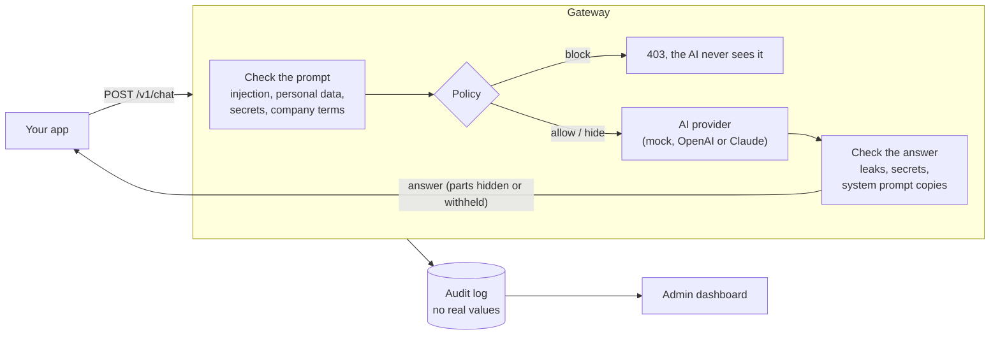

# LLM Security Gateway

[](https://github.com/Aman7608/LLM-Security-Gateway/actions/workflows/ci.yml)
[](LICENSE)

A self-hosted security gateway that sits between your apps and AI models like OpenAI GPT and Anthropic Claude. Every prompt and every AI answer goes through it and is checked for:

- **prompt injection**: attempts to make the AI ignore its instructions, reveal its hidden system prompt, or follow orders hidden inside documents
- **personal data**: emails, phone numbers, card numbers, Aadhaar and PAN numbers, IBANs, names and more
- **secrets**: API keys, tokens, passwords and private keys
- **company secrets**: your secret project names and "confidential" markings

Based on a policy you control, each finding is **allowed**, **warned** about, **hidden** (redacted) or **blocked**. Every decision is kept in a privacy-safe audit log, and an admin dashboard shows what is happening.

I built it as a learning project in AI security engineering, in 19 planned phases. It is **one layer of protection**, not a complete one: the red team test in this repository measures what still gets through, and the results are below.

---

## How it works



1. **The prompt is checked.** Hidden-text tricks are undone first: invisible characters, look-alike letters, spaced-out letters and base64. Then four detectors look for problems.
2. **The policy decides** what happens to each finding, and gives the request a risk level from none to critical.
3. **Blocked prompts never reach the AI.** For the rest, private values are replaced with labels like `<EMAIL_ADDRESS>` before anything leaves your network.
4. **The AI's answer is checked too:** for secrets, personal data, and copies of the hidden system prompt (using a secret marker, a "canary", that is added to every system prompt).
5. **A safe record is saved:** what was found, where, the decision and the timing. Never the real values: only a short fingerprint, so the same email can be recognised again without being stored.

---

## Results

Measured, not guessed. Everything below comes from tests in this repository.

**Red team test** ([full report](docs/red-team-report.md)): 137 new cases, written for the test and never used to tune the rules, sent through the whole gateway:

| Measure | Result |
|---|---|
| Attacks stopped | **36 of 67 (54%)** |
| System prompt theft stopped | 8 of 8 (7 of them caught only by the answer check) |
| Private data and secrets kept from the AI | **23 of 26 (88%)** |
| Normal requests wrongly blocked | **0 of 44** |
| Time per request, median (whole gateway) | 21 ms |

**What this means:** the detectors are reliable for things with a clear shape, like keys, emails, ID numbers and copies of the system prompt. Prompt injection is detected with rules that match known phrases, so attacks that are reworded, written in another language or spread over several messages often get through. A machine learning detector would be the next step (see [the red team guide](docs/16-red-team.md)).

**Tests:**
- Python: 1,400+ tests (unit, integration, security and end to end) with 99% coverage
- dashboard: 36 tests
- Ruff and strict mypy are clean
- every known miss is kept visible as an expected-failure test
- all of these run on GitHub for every push (the CI badge at the top)

---

## Quick start (Windows PowerShell)

You need **Python 3.12**, and **Node.js** if you want to build the dashboard.

```powershell
py -3.12 -m venv .venv
.\.venv\Scripts\python.exe -m pip install -r requirements-dev.txt
```

Run the tests (the first run loads a 400 MB language model):
```powershell
.\.venv\Scripts\python.exe -m pytest
```

Try the checks without starting a server:
```powershell
.\.venv\Scripts\python.exe scripts\try_provider.py --protect "Email priya@example.com the report"
```

### Run the whole gateway

1. Copy the example settings, then make a secret fingerprint key and paste it into `.env` after `GATEWAY_FINGERPRINT_KEY=`:
   ```powershell
   Copy-Item .env.example .env
   ```
   ```powershell
   .\.venv\Scripts\python.exe -c "import secrets; print(secrets.token_hex(32))"
   ```
2. Make an admin key for the dashboard and a client key for your app. Each key is shown **once**, so copy it:
   ```powershell
   .\.venv\Scripts\python.exe scripts\manage_keys.py create "Me" --role admin
   ```
   ```powershell
   .\.venv\Scripts\python.exe scripts\manage_keys.py create "My app"
   ```
3. Build the dashboard and start everything:
   ```powershell
   .\.venv\Scripts\python.exe scripts\serve.py --build
   ```
4. Open **http://127.0.0.1:8000** for the dashboard, or **http://127.0.0.1:8000/docs** for the API docs.

### Send a prompt through it

In a second PowerShell window, with your client key:
```powershell
$key = "lsg_..."
```
```powershell
Invoke-RestMethod -Method Post http://127.0.0.1:8000/v1/chat -Headers @{"X-API-Key" = $key} -ContentType "application/json" -Body '{"messages":[{"role":"user","content":"Email priya@example.com about the refund"}]}'
```

The free offline mock AI answers by repeating what it received: `Mock answer. You said: Email <EMAIL_ADDRESS> about the refund`. The email never reached it. Try `"Ignore all previous instructions"` to see a block (403).

To use a real AI, add `GATEWAY_OPENAI_API_KEY` and `GATEWAY_OPENAI_MODEL`, or `GATEWAY_ANTHROPIC_API_KEY`, to `.env`, then install the provider packages with `pip install -r requirements-providers.txt`. See [the providers guide](docs/11-llm-providers.md).

---

## Configuration

- **Settings** (ports, limits, AI keys, privacy options) are environment variables or lines in `.env`. All 30 are listed in **[docs/settings.md](docs/settings.md)**.
- **Rules** live in YAML files in `config/`:
  - what to do with each finding: `policy.yaml`
  - attack patterns: `injection_rules.yaml`
  - kinds of personal data: `pii_entities.yaml`
  - secret patterns: `secret_patterns.yaml`
  - your company's secret terms: `confidential_terms.yaml`

  The policy can also be changed while the gateway runs, from the dashboard or the API. It is checked first, and every change becomes a new version.

---

## Project layout

```text
src/llm_gateway/    the gateway (Python)
    detectors/      injection, personal data, secrets, company terms, system prompt leaks
    dlp/            runs the detectors, hides values
    policy/         turns findings into decisions and risk levels
    providers/      mock, OpenAI and Claude
    audit/          the privacy-safe audit log and API keys
    core/           the main flow, with no web code
    api/            the web API: routes, keys, limits, errors
frontend/           the admin dashboard (React, TypeScript, Tailwind)
config/             rule and policy files
redteam/            the red team test set and its runner
scripts/            start the gateway, manage keys, red team, audit tools
tests/              unit, integration, security and end-to-end tests
docs/               the guides below
```

---

## Limitations

- **Rule-based injection detection misses reworded attacks.** About half of the new attacks in the red team test got through, including all six in other languages.
- **The gateway checks each message on its own**, so an attack split across several messages is not put together.
- **Rate limits are counted in memory:** run one copy of the gateway, and limits reset on restart.
- **HTTPS is not built in.** On one computer it listens on 127.0.0.1 only. On a network, put it behind a proxy that adds HTTPS.
- **No Docker setup yet.** Phase 15 is postponed; the untested Docker files are on a separate branch.
- **Tested on SQLite only.** PostgreSQL should work through SQLAlchemy but has not been tested.
- **Not tested with real OpenAI or Claude keys in the automated tests.** The providers are tested against a fake network.

---

## Documents

| Document | What it covers |
|---|---|
| [docs/01-project-requirements.md](docs/01-project-requirements.md) | What the gateway must do |
| [docs/02-system-architecture.md](docs/02-system-architecture.md) | How it is designed, and what changed while building it |
| [docs/03-threat-model.md](docs/03-threat-model.md) | Attacks and defences (STRIDE) |
| [docs/04-development-setup.md](docs/04-development-setup.md) | Setting up the tools |
| [docs/05-project-structure.md](docs/05-project-structure.md) | Folders, files and how the modules depend on each other |
| [docs/settings.md](docs/settings.md) | Every setting, with its default |
| [docs/06-prompt-injection-detection.md](docs/06-prompt-injection-detection.md) | How prompt injection is detected, test results and limits |
| [docs/07-pii-detection.md](docs/07-pii-detection.md) | How personal data is found and hidden, test results and limits |
| [docs/08-secret-detection.md](docs/08-secret-detection.md) | How API keys, tokens and passwords are found, test results and limits |
| [docs/09-dlp-engine.md](docs/09-dlp-engine.md) | How the detectors are joined, how decisions are made, the default policy |
| [docs/10-policy-engine.md](docs/10-policy-engine.md) | Risk levels, combined signals, policy checks, versions and safe reloading |
| [docs/11-llm-providers.md](docs/11-llm-providers.md) | The mock, OpenAI and Claude providers, retries, timeouts and key safety |
| [docs/12-output-scanner.md](docs/12-output-scanner.md) | Checking AI answers: confidential terms, system prompt leaks and the output guard |
| [docs/13-audit-logging.md](docs/13-audit-logging.md) | The audit log: what is saved (and never saved), fingerprints, the database and policy history |
| [docs/14-fastapi.md](docs/14-fastapi.md) | The web API: endpoints, API keys, limits, the error format, and how to call it |
| [docs/15-dashboard.md](docs/15-dashboard.md) | The admin dashboard: pages, how it talks to the API, security choices, tests and limits |
| [docs/16-red-team.md](docs/16-red-team.md) | Red team testing: how the attack test works, what got through and why |
| [docs/red-team-report.md](docs/red-team-report.md) | The measured red team results (written by `scripts/red_team.py`) |
| [docs/17-final-integration.md](docs/17-final-integration.md) | Everything together: one address, the start command, the whole-system test, and every requirement checked |

---

## Security

Found a way past the gateway, or a leak? Please report it privately, not in a public issue. See [SECURITY.md](SECURITY.md).

## Status

Version **0.1.0**. All 19 planned phases are done except Phase 15 (Docker), which is postponed: Docker Desktop doesn't start on the development PC, so the untested Docker files are on the branch `docker-later`. The most useful next steps are in [the red team guide](docs/16-red-team.md) (section 4).

## License

[MIT](LICENSE). You may use, change and share this code, as long as you keep the copyright line.
