# LLM Security Gateway: System Architecture

Phase 2 document, part 1 of 2. Written on 18 November 2026.
The threat model is in [03-threat-model.md](03-threat-model.md).

This document shows how the gateway is put together: the main parts, how data moves between them, and what happens when something goes wrong. Requirement IDs like FR-27 point back to [01-project-requirements.md](01-project-requirements.md).

> The diagrams are written in **Mermaid**, a way of drawing diagrams with text. GitHub shows them as pictures automatically. In VS Code, install the *Markdown Preview Mermaid Support* extension and press `Ctrl+Shift+V`.

---

## 1. Design rules

Before drawing anything, we agree on a few rules. They help us make the same kind of choice every time.

| # | Rule | What it means in practice |
|---|---|---|
| 1 | **Block when unsure** | If a check crashes or cannot finish, block the request. Never let it through unchecked |
| 2 | **Trust nothing from outside** | User prompts, documents, web pages *and the AI's answers* all get checked |
| 3 | **Finding and deciding are separate jobs** | Detectors only report what they found. Only the policy engine decides what to do |
| 4 | **Save as little as possible** | Logs never contain real secrets or personal data |
| 5 | **Parts can be swapped** | Detectors and AI providers follow a shared interface, so new ones plug in easily |
| 6 | **Rules live in config files** | Changing a rule should not need a code change |
| 7 | **Works offline** | With the mock provider, everything runs without internet or API keys |

Rule 3 is the most important one. It means we can add a new detector without touching the policy code, and change a policy without touching the detector code.

---

## 2. High-level architecture

The big picture: who talks to whom.

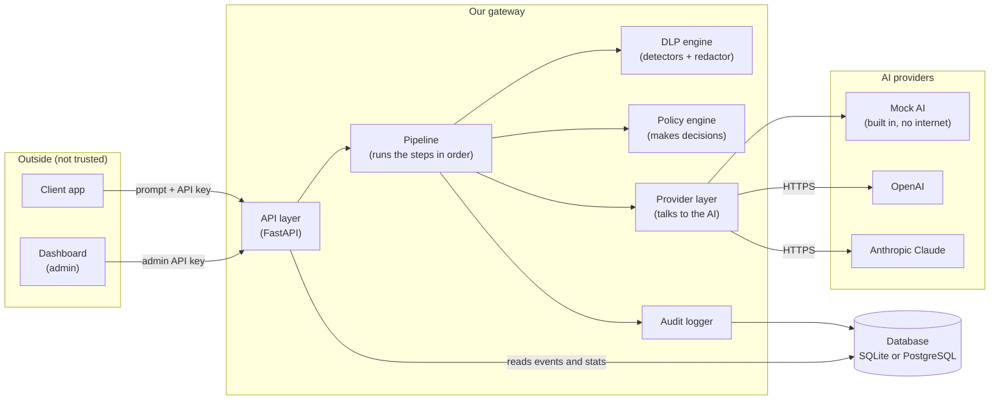

**How to read it**

- **Left:** the client app sends prompts. The dashboard is used by the admin. We do not control either of them, so we do not trust them.
- **Middle:** our gateway, one Python program. The **pipeline** runs each step in the right order. It asks the DLP engine to check the text, the policy engine to decide, the provider layer to call the AI, and the logger to record what happened.
- **Right:** the AI providers. The mock AI runs inside our program. OpenAI and Claude are optional and only used when an API key is set.
- **Bottom:** the database stores the audit log, policy versions and app API keys (as hashes). The dashboard never reads the database directly. It always goes through the API.

**Why one program and not many small services?** Splitting the gateway into many services (microservices) would add network calls, slow things down and make it harder to run, with no real benefit at this size. We still keep the code split into clear modules, so it stays easy to understand. Because the API keeps nothing in memory between requests, we can run more copies of it later if needed (NFR-06).

---

## 3. Low-level architecture

### 3.1 Component diagram

The same gateway, zoomed in to show the Python modules we will write.

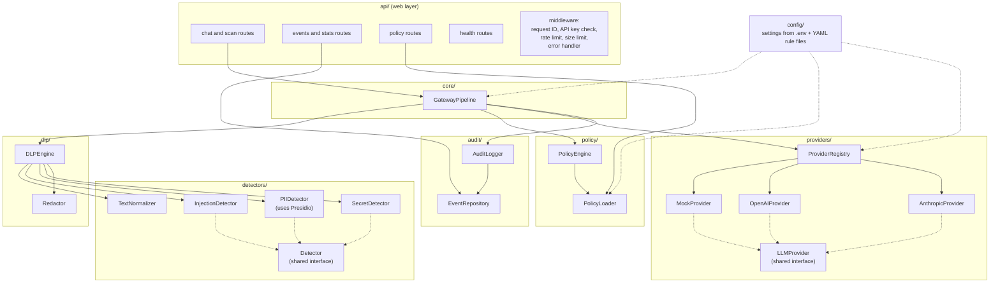

**How to read it**

- Each group is a Python folder (package) that we create in Phase 4.
- A **solid arrow** means "uses". A **dotted arrow** to an interface means "follows the shape of". For example, all three detectors follow the shared `Detector` interface.
- Arrows only point one way: routes use the pipeline, the pipeline uses the engines, the engines use the detectors. Detectors use nothing else in our project, so they are easy to test on their own.
- Only the pipeline knows the full order of steps. Every other part does one job.
- Settings are passed into the parts when the program starts, instead of each part reading `.env` by itself. This is called **dependency injection**. It makes testing easy, because a test can pass in its own settings.

### 3.2 What each part does

| Part | Its job | Not its job |
|---|---|---|
| **Middleware** | Give each request an ID, check the API key, apply rate limits and size limits, turn errors into safe JSON | Security decisions |
| **GatewayPipeline** | Run the steps in order: check prompt, decide, call AI, check answer, decide, log | Detection or decision rules |
| **TextNormalizer** | Make a cleaned-up copy of the text for checking: remove invisible characters, fix spacing, ignore case. Lives in `detectors/` (moved there in Phase 5, because detectors may not import from `core/`). Base64 decoding is done by the injection detector | Change the text that is sent to the AI |
| **InjectionDetector** | Look for prompt injection using rules from a YAML file | Block anything |
| **PIIDetector** | Ask Presidio to find personal data | Hide it (the Redactor does that) |
| **SecretDetector** | Look for keys, tokens and passwords | Store the secret |
| **DLPEngine** | Run all detectors, combine their findings, remove duplicates, hand redaction to the Redactor | Decide the action |
| **Redactor** | Replace found text with labels like `<EMAIL_ADDRESS>` | Decide what to hide |
| **PolicyEngine** | Turn findings into a final action, a risk level and reasons | Run detectors |
| **PolicyLoader** | Read the policy YAML, check it for mistakes, keep the last working version | |
| **ProviderRegistry** | Hand out the chosen AI provider; refuse providers with no API key | |
| **Providers** | Send messages to the AI, handle timeouts and retries, return answers in one shared format | Security checks |
| **AuditLogger** | Build a safe log record and save it; write to the console if the database fails | Save real secrets |
| **EventRepository** | Read from and write to the database, and work out statistics | |

### 3.3 Main data objects

These are the pieces of data passed between the parts. In the code they will be Pydantic models.

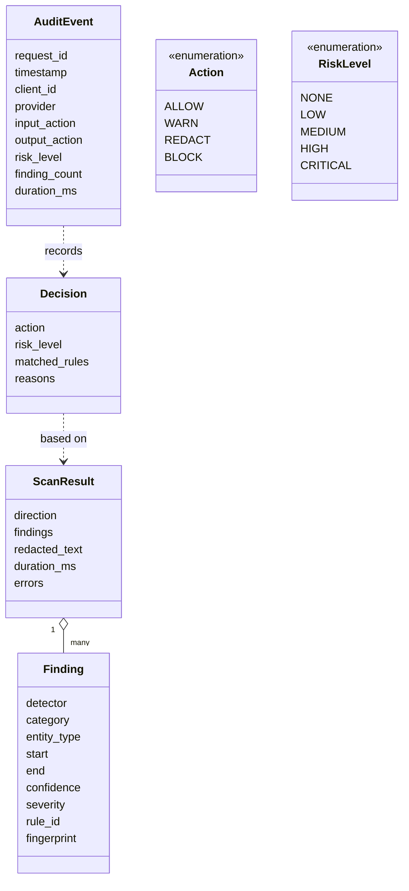

**How to read it**

- A **Finding** is one thing a detector found. It stores *where* the item is (`start` and `end` positions) and a short **fingerprint**, but **not the actual text**. That way the log can say "an AWS key was found at characters 40 to 60" without saving the key.
- A **ScanResult** is everything found in one piece of text, in one direction: the prompt (`INPUT`) or the answer (`OUTPUT`).
- A **Decision** is what the policy engine decided, with plain reasons (FR-31).
- An **AuditEvent** is the row saved to the database for each request.
- `Action` and `RiskLevel` are **enums**: fixed lists of allowed values, so a typo like `"BLOK"` cannot sneak in.

**What is a fingerprint?** It is a short code made from the secret using a one-way function (an HMAC with a private key, called a "salt"). The same secret always gives the same fingerprint, so we can see "this key appeared in 14 requests". But nobody can turn the fingerprint back into the secret.

### 3.4 Shared interfaces

Any class with these methods can be plugged in. This is how we meet NFR-09 (easy to extend).

```text
Detector
    name
    scan(text) -> list of Finding

LLMProvider
    name
    complete(chat_request) -> chat_response      (async)
    health() -> True or False                    (async)

PolicyEngine
    evaluate(scan_result, direction) -> Decision
```

---

## 4. How the policy engine decides

### 4.1 The steps

1. **Drop weak findings.** Ignore any finding whose confidence is below the threshold for its type.
2. **Look up an action for each finding** in the policy for that direction. Example policy:

   ```yaml
   input:
     prompt_injection: { min_confidence: 0.7, action: BLOCK }
     secret:           { min_confidence: 0.5, action: REDACT }
     pii:
       default:        { min_confidence: 0.6, action: REDACT }
       PERSON:         { min_confidence: 0.85, action: WARN }
   output:
     secret:           { action: BLOCK }
     pii:
       default:        { action: REDACT }
   ```

3. **The strictest action wins:** Block, then Redact, then Warn, then Allow (FR-27).
4. **Risk level** is the highest severity among the findings. It goes up one more level when findings from two or more different types appear together, because an attack plus a leaked key is worse than either one alone.
5. **Prompt injection cannot be redacted.** Cutting out part of an attack does not make the rest safe. So injection findings can only be Warn or Block, and the policy loader refuses any policy that says otherwise.

### 4.2 Decision flow

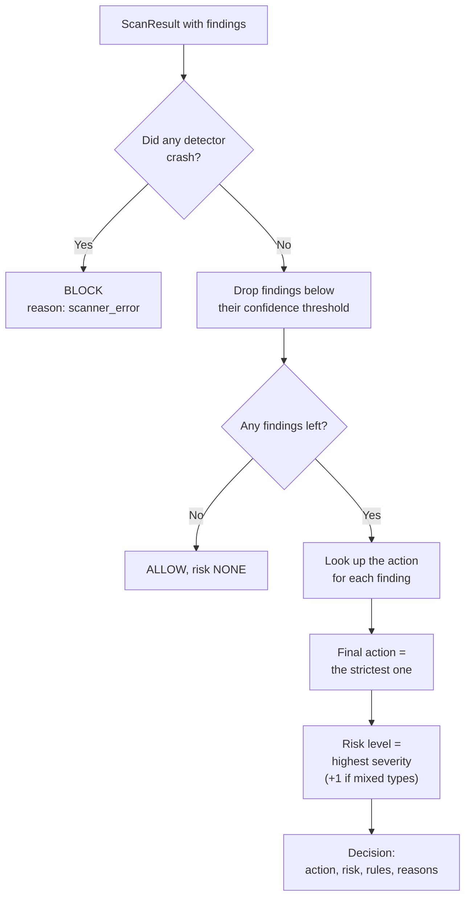

**How to read it**

Start at the top and follow the arrows. The first question is a safety check: if a detector crashed, we do not pretend the text is clean (design rule 1). The admin can switch this to "let it through with a warning", and that change is logged. After that, weak findings are dropped, each remaining finding gets an action, and the strictest action wins.

---

## 5. Data flow diagrams

A data flow diagram (DFD) shows where data comes from, what changes it, and where it is stored. It does not show timing.

### 5.1 Level 0: the whole system as one box

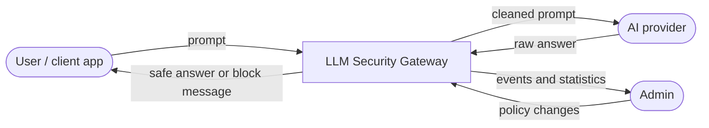

**How to read it**

The gateway is one box, and we only look at what goes in and out. The key point: the AI only ever receives a **cleaned** prompt, and the user only ever receives a **checked** answer.

### 5.2 Level 1: inside the gateway

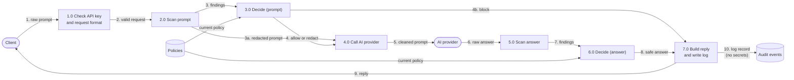

**How to read it**

Follow the numbers. Rectangles change data, and cylinders store it.
- **Arrow 3a:** when the decision is Redact, the *redacted* prompt is what continues to the AI, not the original.
- **Arrow 4b:** a blocked prompt skips the AI completely.
- **Arrow 10:** only the safe log record is stored.

---

## 6. Sequence diagrams

A sequence diagram shows **who calls whom, in what order**. Time goes from top to bottom.

### 6.1 Normal request where an email gets hidden

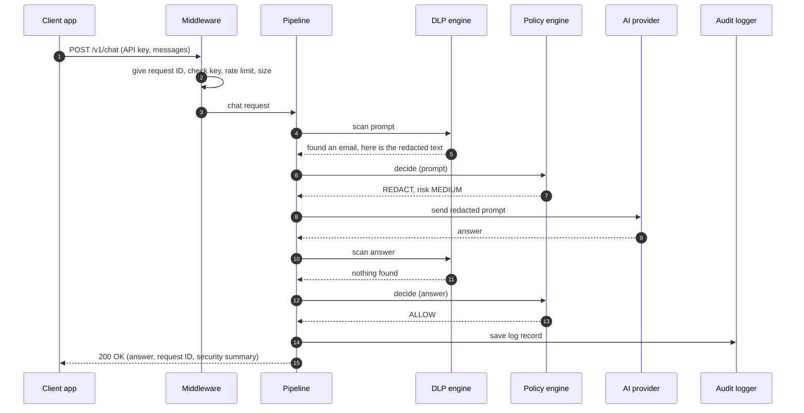

**How to read it**

- Steps 4 to 7 check the prompt.
- Step 8 is the only moment data leaves for the AI.
- Steps 10 to 13 check the answer the same way.

The client gets a short security summary saying the prompt was redacted, so the app can let its user know.

### 6.2 Prompt injection gets blocked

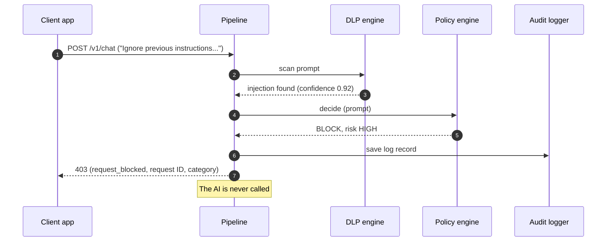

**How to read it**

When the prompt is blocked, the AI is never contacted. This saves money and keeps the attack away from the model. The reply says *what kind* of problem was found (`prompt_injection`) but not *which rule* matched. If we showed the exact rule, an attacker could reword their attack until it slips past.

### 6.3 The AI provider fails and we retry

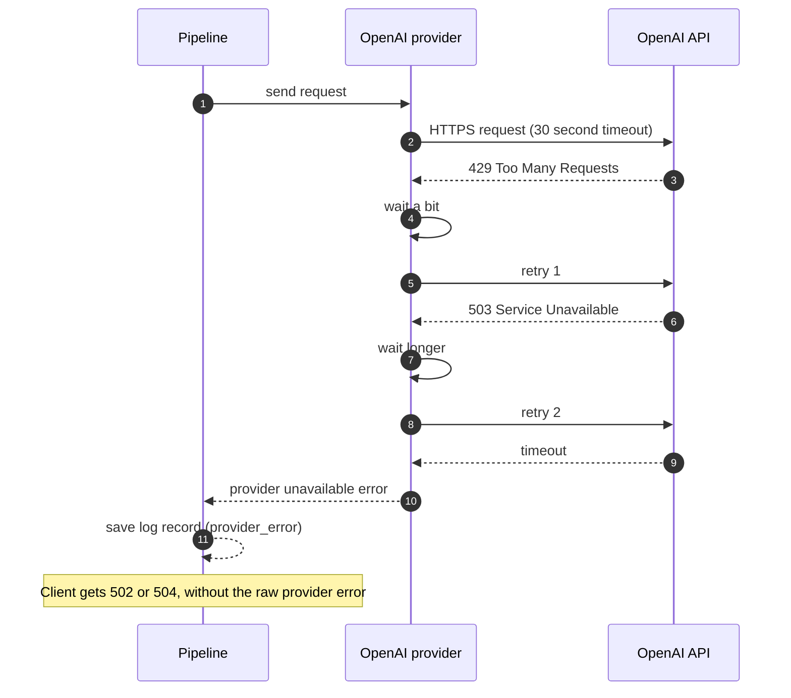

**How to read it**

- We only retry errors that might fix themselves: 429 (too many requests), 5xx (server errors) and timeouts.
- Errors like 400 (bad request) or 401 (wrong key) are not retried, because trying again will not help.
- The wait gets longer each time, with a little randomness added. This is called **exponential backoff with jitter**. It stops every client from retrying at the exact same moment.
- The provider's own error message is logged but not sent to the client, because it can contain account details.

---

## 7. Request and response processing

### 7.1 Processing a prompt

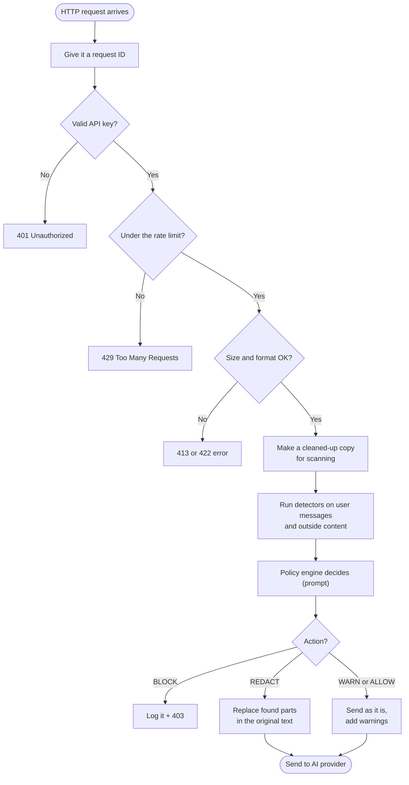

**How to read it**

- **Cheap checks come first.** The API key, rate limit and size checks run before the slow NLP checks. This means someone without a valid key cannot make the gateway do heavy work, which protects against simple overload attacks.
- **We scan a cleaned copy, but redact the original.** The cleaned copy (lowercase, no invisible characters, fixed spacing) makes attacks harder to hide. But we do not want to send that strange-looking version to the AI. So the normalizer keeps a map from positions in the cleaned copy back to positions in the original, and redaction uses the original.

### 7.2 Processing an answer

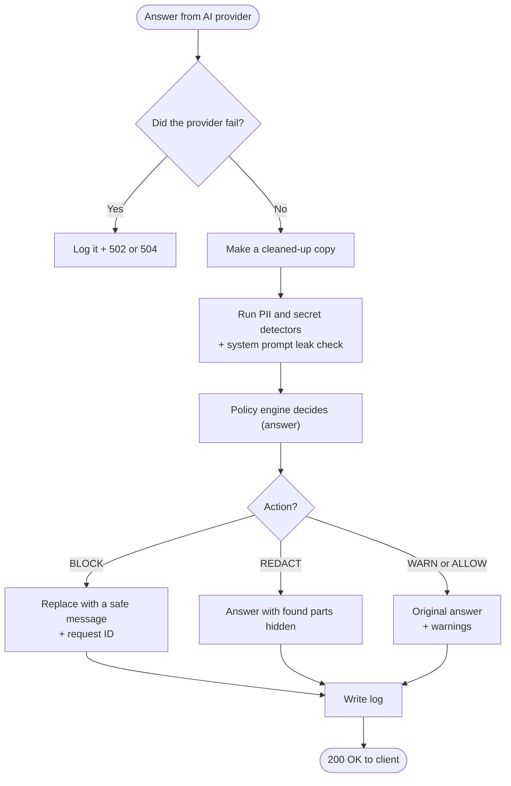

**How to read it**

- Answers use the same detectors as prompts, but a **separate answer policy** (FR-30).
- A blocked *answer* still returns **200 OK**, with a safe placeholder message and `blocked: true`. The client's request was fine; only the AI's answer was unsafe.
- A blocked *prompt* returns **403**.
- Using two different codes lets the app tell "you sent something bad" apart from "the AI said something we hid".

---

## 8. Database design

### 8.1 Tables

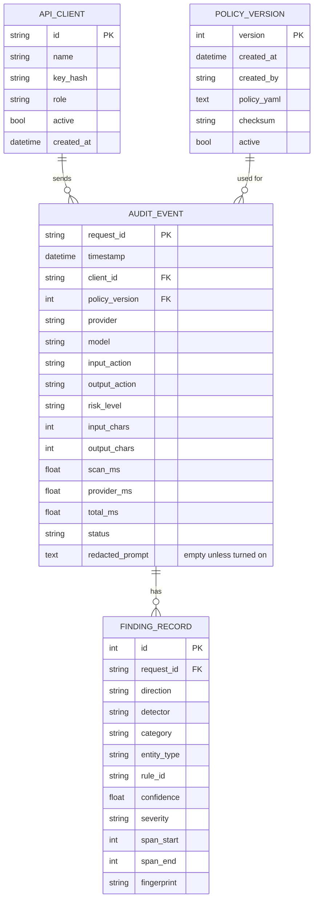

**How to read it**

This is an entity-relationship (ER) diagram. Each box is a database table. `PK` means primary key (the unique ID of a row). `FK` means foreign key (a link to a row in another table). The `||--o{` line means "one to zero or more".

- **API_CLIENT:** one row per app that uses the gateway. We store a **hash** of the API key, never the key itself, the same way websites store passwords. `role` is either `client` or `admin`.
- **AUDIT_EVENT:** one row per request. It holds decisions, counts and timings, not the conversation. `redacted_prompt` is empty by default (FR-46). If an admin turns it on, it only ever holds the redacted version.
- **FINDING_RECORD:** one row per finding, with its position and fingerprint but not the real value (FR-45).
- **POLICY_VERSION:** every policy change makes a new row instead of overwriting the old one. Each audit event records which version made its decision, so old decisions can still be explained after the rules change.

### 8.2 Database choices

| Choice | What we use | Why |
|---|---|---|
| Database library | SQLAlchemy 2 | The same code works with both SQLite and PostgreSQL |
| Schema changes | Alembic | Keeps a history of table changes that can be replayed on any machine |
| Development database | SQLite (a single file) | No setup needed |
| Production database | PostgreSQL | Handles many requests writing at once |
| Indexes | `timestamp`, `risk_level`, `client_id`, and `request_id` on findings | Makes the dashboard filters and stats fast |
| Old data | Deleted after 30 days by default (configurable) | Keeps only what we need (NFR-04) |

---

## 9. Failure handling

What happens when each part fails. Every error reply includes the **request ID**, so the admin can find the matching log entry, while the client never sees internal details.

| What fails | How we notice | What the gateway does | What the client sees |
|---|---|---|---|
| A detector crashes | try/except around each detector | Block (default), or continue with a warning if the admin chose that | 403 `scanner_error` |
| A detector takes too long | Time limit per scan | Same as a crash | 403 |
| Presidio's language model is missing | Check at startup | `/ready` reports not ready, and the gateway refuses traffic | 503 |
| Admin sends a broken policy | Pydantic validation | Rejected; the last working policy stays active | 422 with the list of mistakes |
| Policy file is broken at startup | Validation | Use a built-in strict default policy, and log a loud warning | Normal |
| AI provider timeout, 429 or 5xx | HTTP client error | Retry up to 2 times with growing waits | 504 or 502 after the retries |
| AI provider 400 or 401 | HTTP client error | No retry | 502 `provider_error` |
| No API key for the chosen provider | Check at startup | That provider is turned off | 400 `provider_not_configured` |
| Database write fails | Exception | Still reply. Write the log record to the console instead and count the failure. If the admin turns on "audit required", reply 503 instead | Normal (or 503) |
| Database not reachable at startup | Connection check | `/ready` reports not ready | 503 |
| Rate limit reached | Middleware | Reject before any scanning | 429 with a `Retry-After` header |
| Any other unexpected error | Global error handler | Generic error, no stack trace | 500 `internal_error` |

---

## 10. Planned API endpoints

A preview of what Phase 13 builds.

| Method | Path | Who can use it | What it does |
|---|---|---|---|
| GET | `/health` | anyone | Is the program running? |
| GET | `/ready` | anyone | Are the database, policy and language model loaded? |
| POST | `/v1/chat` | client | Send a prompt through the full gateway |
| POST | `/v1/scan` | client | Only check text, without calling any AI |
| GET | `/v1/events` | admin | List log events, with filters and pages |
| GET | `/v1/events/{request_id}` | admin | One event with its findings |
| GET | `/v1/stats` | admin | Totals and charts data for the dashboard |
| GET | `/v1/policies/active` | admin | See the current policy |
| PUT | `/v1/policies/active` | admin | Replace the policy (creates a new version) |
| POST | `/v1/policies/validate` | admin | Check a policy without applying it |
| GET | `/v1/providers` | client | List the AI providers that are set up |

---

## 11. Main technical choices

| Area | We use | Why | Instead of |
|---|---|---|---|
| Web framework | FastAPI | Checks request data, supports async, writes API docs automatically | Flask (no built-in data checking) |
| Data models | Pydantic 2 | Typed models for requests, findings and policies | Writing checks by hand |
| PII detection | Presidio + spaCy English model | Mature, combines patterns and NLP, can redact | Building our own NLP |
| Secret detection | Our own patterns in a YAML file | Light, easy to change and easy to explain | detect-secrets (heavier, made for scanning files) |
| HTTP calls | httpx | Async, has timeouts, and both AI SDKs use it | requests (blocks while waiting) |
| AI providers | Official `openai` and `anthropic` packages, optional | Correct login and error handling | Raw HTTP calls |
| Database | SQLAlchemy 2 + Alembic | One codebase for SQLite and PostgreSQL | Raw SQL |
| Rate limiting | In-memory counter (Redis optional later) | No extra service needed for one copy of the gateway | Redis from day one |
| Settings | pydantic-settings + YAML files | Typed environment variables and readable rules | Constants in the code |
| Dashboard | React + TypeScript + Vite + Tailwind | Typed, fast to develop, matches the brief | Create React App (no longer maintained) |

Exact versions are chosen and checked in Phase 3.

---

## 12. Changes to the requirements

Nothing was removed. The design made two rules clearer:

1. Prompt injection findings can only be **Warn** or **Block**, never Redact (section 4.1).
2. A blocked **prompt** returns **403**. A blocked **answer** returns **200** with `blocked: true` (section 7.2).

---

## 13. Planned vs built (added in Phase 18)

This document was written in Phase 2, before any code. Most of the design was built as planned. These are the places where the finished gateway is different, and why.

### Added

| What | Phase | Why |
|---|---|---|
| A **ConfidentialDetector** for your secret project names and "confidential" markings | 11 | Company secrets are not personal data or keys, but must not leak either |
| A **system prompt leak check** with a secret marker (a "canary") added to every system prompt | 11 | Catches the AI repeating its hidden instructions, even when the attack itself was missed. In the red team test it stopped 7 attacks that got past the prompt checks |
| **Documents** in a chat request, checked like messages and sent to the AI inside `<document>` tags | 13 | Indirect prompt injection (FR-04) |
| **Earlier assistant messages are checked** too | 13 | The client sends them, so they could be fake |
| `GET /v1/policies/history` and `GET /v1/stats/timeline` | 13, 14 | The dashboard needs the policy versions and a risk chart over time |
| A **limit on the characters in one chat** (`GATEWAY_MAX_REQUEST_CHARS`), checked before scanning | 13 | Measuring showed long texts take seconds to scan, so one big request could keep the gateway busy |
| The gateway **serves the built dashboard** at `/` | 17 | One address, one program, and no CORS settings needed |

### Different from the plan

| Planned | Built | Why |
|---|---|---|
| A time limit per scan (section 9) | Size limits instead: texts over `GATEWAY_MAX_PROMPT_CHARS` are blocked, and whole chats over `GATEWAY_MAX_REQUEST_CHARS` get 413 | A time limit can't stop a scan already running in a thread. Limiting the size before scanning keeps the time short |
| Missing language model: `/ready` says not ready (section 9) | The gateway does not start at all, with a clear error | It can't do its main job without the model, so failing at startup is clearer |
| Tables as in section 8.1 | The same tables, plus a `location` column on `finding_record` (for example `messages[2]`) | A chat has many parts, so the log must say which part a finding was in |
| PostgreSQL for production (section 8.2) | Only SQLite is tested | It works for one copy of the gateway. PostgreSQL support is in the code (SQLAlchemy) but untested |
| Docker (Phase 15) | Postponed | Docker Desktop doesn't start on the development PC. The untested files are on the branch `docker-later` |
| An optional machine learning classifier (FR-14) | Not built | It was a "Could". The red team test shows it is the most useful next step |

### Rules that held up

- **Detectors only import the shared data models and settings**, and the API never imports detectors directly. A test (`tests/unit/test_architecture.py`) checks these import rules on every run, so they could never be broken by accident.
- **Prompt injection is never redacted**, only warned about or blocked (section 4.1).
- A blocked prompt is **403**, a withheld answer is **200** with `blocked: true` (section 7.2).
