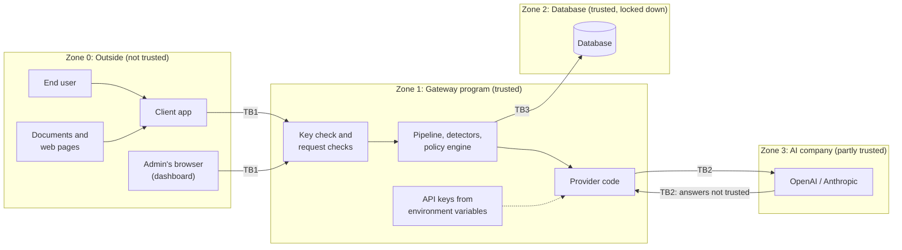

# LLM Security Gateway: Threat Model

Phase 2 document, part 2 of 2. Written on 18 November 2026.
The architecture is in [02-system-architecture.md](02-system-architecture.md).

A **threat model** is a structured way of asking four questions:

1. What are we protecting?
2. Who might attack it, and how?
3. What are we doing about each attack?
4. What risk is still left over?

Writing this down before coding means security is built into the design instead of patched on later.

---

## 1. What we protect (assets)

| ID | Asset | Why it matters |
|---|---|---|
| A1 | Private data in prompts (PII, secrets) | Must not reach the AI company or our logs |
| A2 | Private data in AI answers | Must not reach the user when the policy says no |
| A3 | Our OpenAI and Anthropic API keys | Someone using them costs money and can expose data |
| A4 | Gateway API keys (client and admin) | They let someone use or reconfigure the gateway |
| A5 | The security policy | If someone weakens it, all protection is gone |
| A6 | The audit log | Needed to investigate problems, so it must be trustworthy |
| A7 | The system prompts of apps using the gateway | They often contain business rules |
| A8 | The gateway staying online | Every AI call goes through it, so if it is down, the apps stop working |

---

## 2. Who might attack (threat actors)

| Attacker | What they want | What they can do |
|---|---|---|
| Malicious user | Jailbreak the AI, read the system prompt, pull out data | Write any prompt they like |
| Indirect attacker | Take control of the AI through content it reads | Controls a web page or document that an app feeds to the AI |
| Careless employee | Nothing bad, it is an accident | Pastes secrets or customer data |
| Someone with a stolen client key | Use up quota, test which prompts get blocked | Has a valid client API key |
| Someone with a stolen admin key | Turn off policies, read logs | Has a valid admin API key |
| A broken or compromised AI provider | Return harmful or leaking answers | Controls what the AI sends back |

---

## 3. Trust boundaries

A **trust boundary** is any place where data moves from a less trusted area to a more trusted one (or the other way round). Every time data crosses one, it must be checked.

**How to read it**

Each coloured box is a **zone**: an area where everything has the same level of trust. The arrows marked TB1, TB2 and TB3 are where data crosses between zones.

- **TB1, outside to gateway.** This is the main boundary. Everything arriving here is untrusted, *including content the app did not write itself*, like documents and web pages. It is checked by the API key check, the request checks and the prompt scan.
- **TB2, gateway to AI company and back.** Going out, data must be cleaned, because we are sending it to another company. Coming back, the answer is **not trusted**: the AI can be tricked, can make up fake secrets, or can repeat private data from its context. This is why the gateway checks answers too.
- **TB3, gateway to database.** Only the gateway may talk to the database. The database is never reachable from outside the Docker network.
- **A hidden boundary inside Zone 0.** Documents and web pages are less trustworthy than what the user typed. The "outside content" field in a request (FR-04) keeps this difference, so the detectors can check that content separately.

**Why is the AI company only "partly" trusted?** We trust them to run their service and keep our account safe. We do not trust what their model *says*, because a model's output can be steered by the attacker's input.

---

## 4. Security boundaries (where we enforce rules)

Trust boundaries say *where* checks are needed. Security boundaries are *the actual checks*.

| Check | How it works | Protects |
|---|---|---|
| SB1 API key login | Look up the hash of the key and compare it in constant time | A4, A5 |
| SB2 Admin role | Policy and log endpoints need an `admin` key | A5, A6 |
| SB3 Request limits | Maximum body size, number of messages and characters, plus format checks | A8 |
| SB4 Rate limits | A limited number of requests per key per minute | A3, A8 |
| SB5 Prompt scan and policy | Injection, PII and secret checks before calling the AI | A1, A7 |
| SB6 Outgoing traffic | Only the provider code calls out, and only to fixed provider addresses | A1, A3 |
| SB7 Answer scan and policy | PII, secret and leak checks before replying | A2, A7 |
| SB8 Safe logging | Fingerprints instead of values, redacted text only, log filters | A1, A3, A6 |
| SB9 Key storage | Provider keys come only from environment variables. They are never logged or returned by any endpoint | A3 |

**What is a constant-time comparison?** A normal comparison stops at the first wrong character, so a wrong key that starts correctly takes slightly longer to reject. An attacker can measure that time difference to guess a key one character at a time. A constant-time comparison always takes the same time. Python has one built in: `hmac.compare_digest`.

---

## 5. STRIDE analysis

STRIDE is a checklist made by Microsoft. For each part of the system, we ask whether someone could do each of these six things:

| Letter | Threat | Plain meaning |
|---|---|---|
| **S** | Spoofing | Pretending to be someone or something else |
| **T** | Tampering | Changing data or code they should not change |
| **R** | Repudiation | Denying they did something, with no proof either way |
| **I** | Information disclosure | Seeing data they should not see |
| **D** | Denial of service | Making the system slow or unavailable |
| **E** | Elevation of privilege | Getting more power than they should have |

### 5.1 The analysis

The **Risk left over** column is the honest part. It says what is still possible *after* our defences.

| # | Type | Where | Threat | Our defence | Risk left over |
|---|---|---|---|---|---|
| S1 | Spoofing | API | Attacker uses a stolen or guessed client key | Long random keys, stored as hashes, constant-time check, keys can be turned off, rate limits | A stolen key works until someone turns it off |
| S2 | Spoofing | Prompt text | Text pretends to be a system message (`</system>`, "SYSTEM:") | Injection detector looks for fake system messages; message roles only come from proper request fields, never from the text | New formats we have not seen |
| S3 | Spoofing | AI provider | A fake server pretends to be OpenAI or Anthropic | HTTPS with certificate checks; provider addresses fixed in config | Low |
| T1 | Tampering | Policy | Policy weakened through the API | Admin key needed, policy checked for mistakes, every version kept, every change logged | A stolen admin key |
| T2 | Tampering | Detection | Hidden text tricks (look-alike letters, invisible characters, Base64, spacing) to get past the rules | Text clean-up, decode and re-check, several different detectors | **Medium. Reworded attacks will always be possible** |
| T3 | Tampering | Audit log | Log rows changed or deleted | Database not reachable from outside; in production, the app's database user can only add and read rows | A database administrator can still change rows |
| R1 | Repudiation | Requests | An app denies sending a request | Every event has a request ID, client ID and time, and the request ID is sent back to the caller | Low |
| R2 | Repudiation | Policy changes | An admin denies changing the policy | Each policy version records who made it and a checksum | Low |
| I1 | Disclosure | Prompt to AI | PII or secrets sent to the AI company | Prompt scan with Redact or Block | PII the detectors miss (name detection is not perfect) |
| I2 | Disclosure | AI to user | AI leaks PII, secrets or the system prompt | Answer scan, system prompt leak check | Reworded leaks |
| I3 | Disclosure | Logs | Real secrets end up in logs or the database | Fingerprints only, redacted text only, prompt saving off by default, log filters | A developer turning on the wrong setting |
| I4 | Disclosure | Error replies | Stack traces or provider errors shown to the client | Global error handler returns generic errors; details only in our own logs | Low |
| I5 | Disclosure | Block replies | Detailed rule info helps attackers reword their attack | Reply shows the category only, not the rule or score | Attackers can still try many prompts and see which pass |
| D1 | Denial of service | API | Flood of requests | Rate limits, key check before any scanning | Large attacks from many machines need protection from the hosting setup |
| D2 | Denial of service | Detectors | Huge inputs, or regex patterns that take forever on certain text (ReDoS) | Size limits, regex patterns reviewed and tested, time limit per scan | Low |
| D3 | Denial of service | AI provider | The provider is slow or down | Timeouts, limited retries, clear 502 or 504 | When the provider is down, the gateway cannot answer either |
| D4 | Denial of service | Cost | Attacker burns through the paid AI quota | Rate limits, maximum tokens per request, mock provider as the default | Low |
| E1 | Elevation | API | Client key used on admin endpoints | Role check on every admin route, with a test for each one | Low |
| E2 | Elevation | The AI | Injection makes the AI misuse the app's own access (tools, data) | Detect and block at the gateway; advise apps to give the AI as little access as possible | **High in general. This is mostly outside the gateway's control** |
| E3 | Elevation | Dashboard | Malicious text in the logs runs as code in the admin's browser (XSS) | React escapes text by default, we never use `dangerouslySetInnerHTML`, only redacted data is shown, Content Security Policy header | Low |

### 5.2 What the analysis tells us

Most threats can be pushed down to low risk with normal security practice: hashing keys, checking roles, limiting sizes, handling errors carefully.

Four rows stay at medium or high risk: **T2, I1, I2 and E2**. They all come from the same root problem: an AI model reads instructions and data as one stream of text, and natural language has endless ways to say the same thing. These are the core limits of *any* AI firewall, not only ours. This is why the requirements call the gateway "one layer of protection" (Limitation 1), and why Phase 16 measures how many attacks get through instead of claiming none do.

---

## 6. How the threat model shapes the code

| Threat | Where it turns into code | Phase | Built? (checked in Phase 18) |
|---|---|---|---|
| T2 hidden text tricks | `TextNormalizer` and the decode-and-re-check step | 5 | Yes. Base64, invisible characters, look-alike letters and spacing are undone. ROT13, reversed text and hex are not (red team) |
| I1 PII sent to the AI | `PIIDetector` and the Redactor | 6, 8 | Yes. Red team: 9 of 10 hidden before the AI saw them |
| I1, I2 secrets | `SecretDetector` | 7 | Yes. Red team: 8 of 10 hidden |
| T1 weakened policy | `PolicyLoader` checks and policy versions | 9 | Yes. Broken policies are refused, every change is a saved version with who made it |
| S3 fake provider, D3 provider down | HTTPS, timeouts and retries in the providers | 10 | Yes |
| I2 leaking answers | Answer scanning | 11 | Yes, plus a canary in every system prompt. Red team: all 4 answer leaks and all 8 system prompt thefts stopped |
| I3 secrets in logs | Fingerprints and safe audit records | 12 | Yes. A test searches the database file byte by byte for planted values (Phase 17) |
| S1, E1, D1, I4 | Key check, roles, rate limits, error handler | 13 | Yes |
| E3 XSS | Safe rendering in the dashboard | 14 | Yes, plus a strict Content-Security-Policy on the dashboard pages (Phase 17) |
| T3, TB3 database access | Docker network setup | 15 | **Not yet.** Docker is postponed. The database is a local file, protected only by the computer's own file permissions |
| All of them | Red team test cases for each row of the STRIDE table | 16 | **Partly.** The red team covers the AI-specific rows (T2, I1, I2). The API rows (S1, E1, D1, I4) are covered by `tests/security/test_api_security.py` and the API tests instead |

The rows that stay at medium or high risk (T2, I1, I2, E2) were measured in the red team test: 31 of 67 new attacks got through. See [16-red-team.md](16-red-team.md).
