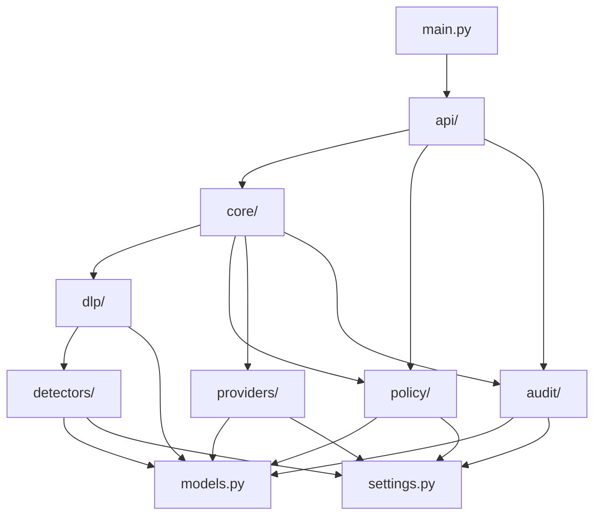

# Project Structure

Phase 4 document. Written on 18 November 2026.

This document explains every folder and important file, how the modules depend on each other, how settings work, and how the tests are organised.

---

## 1. The folder tree

The tree as it is at the end of Phase 18 (it was first written in Phase 4, when most folders were still empty):

```text
LLM Security Guard New/
├── .env.example              example settings (copy to .env)
├── .editorconfig             editor spacing and line endings
├── .gitattributes            line endings stored in git
├── .gitignore                files git must never save
├── .vscode/                  VS Code settings and extensions
├── README.md                 what it is, results, quick start
├── alembic.ini               database migration settings (Phase 12)
├── pyproject.toml            project info + pytest, ruff, mypy settings
├── requirements.txt          packages needed to run (pinned)
├── requirements-dev.txt      + test and code-check tools
├── requirements-providers.txt  + the OpenAI and Anthropic packages (optional)
│
├── config/                   rule and policy files (see config/README.md)
│   ├── policy.yaml               what to do with each finding (Phase 9)
│   ├── injection_rules.yaml      prompt injection patterns (Phase 5)
│   ├── pii_entities.yaml         kinds of personal data (Phase 6)
│   ├── secret_patterns.yaml      key, token and password patterns (Phase 7)
│   ├── confidential_terms.yaml   your secret project names (Phase 11)
│   └── examples/                 example policies
│
├── docs/                     all project documents (listed in the README)
│
├── frontend/                 the admin dashboard: React + TypeScript (Phase 14)
│   ├── src/                      pages, components, API client, tests
│   └── dist/                     the built dashboard (not in Git)
│
├── redteam/                  the red team test set and its runner (Phase 16)
│
├── scripts/
│   ├── serve.py              start the whole gateway (Phase 17)
│   ├── manage_keys.py        create and disable API keys (Phase 13)
│   ├── red_team.py           run the red team, write the report (Phase 16)
│   ├── audit_tool.py         look at the audit log by hand (Phase 12)
│   ├── try_provider.py       try a prompt through the checks (Phase 10)
│   ├── injection_report.py   injection detector numbers (Phase 5)
│   └── check_env.py          checks the development setup (Phase 3)
│
├── src/
│   └── llm_gateway/          our Python package (all gateway code)
│       ├── __init__.py       package version
│       ├── main.py           creates the FastAPI app, serves the dashboard
│       ├── settings.py       all settings, read from environment variables
│       ├── models.py         shared data objects (Finding, Decision, ...)
│       ├── api/              HTTP routes, keys, rate limits, errors (Phase 13)
│       ├── core/             the main flow, with no web code (Phases 8, 13)
│       ├── detectors/        injection, PII, secrets, confidential terms,
│       │                     system prompt leaks (Phases 5-7, 11)
│       ├── dlp/              runs detectors, redacts text (Phase 8)
│       ├── policy/           turns findings into decisions (Phase 9)
│       ├── providers/        mock, OpenAI, Claude (Phase 10)
│       └── audit/            privacy-safe logging, API keys, migrations (Phase 12)
│
└── tests/
    ├── conftest.py           shared test setup
    ├── data/                 fake samples (attacks, personal data, fake secrets)
    ├── unit/                 one piece at a time
    ├── integration/          several pieces together
    ├── security/             attacks, leaks and the red team
    └── e2e/                  the whole system (a real server, the whole-system story)
```

Not in Git, but created on your computer: `.venv/` (virtual environment), `.env` (your real settings, if you make one), `data/` (the database), and `frontend/node_modules/` and `frontend/dist/`.

The Docker files (Phase 15) are on the branch `docker-later` until Docker is finished.

---

## 2. Why the code lives in `src/`

This is called the **src layout**. Our package sits at `src/llm_gateway/` instead of `llm_gateway/` at the top level.

**The problem it solves:** without it, Python can import the package straight from the project folder, even if it was never installed properly. Tests would pass on your computer but fail inside Docker. With `src/`, the tests always use the *installed* package, the same way Docker will.

**How it gets installed:** `requirements-dev.txt` has the line `-e .`. That installs our own package in **editable** mode: Python links to the `src` folder instead of copying it, so code changes work right away without reinstalling.

```powershell
.\.venv\Scripts\python.exe -c "import llm_gateway; print(llm_gateway.__file__)"
# ...\LLM Security Guard New\src\llm_gateway\__init__.py
```

---

## 3. Every important file

### `pyproject.toml`
The standard Python project file. It holds:
- the project name, version and Python version (`>=3.12`)
- where the code is (`src/`)
- settings for **pytest** (where the tests are, the four test groups)
- settings for **coverage**, **ruff** and **mypy** (strict mode)

Package versions are **not** pinned here. Pins stay in the requirements files, so there is one place to look.

**Ruff rules we turned on:** PEP 8 style (`E`, `W`), real errors (`F`), import order (`I`), common bugs (`B`), modern syntax (`UP`) and **security problems** (`S`, from a tool called Bandit). The `S` rules already caught one thing: a `subprocess` call in `check_env.py`. It turned out to be safe, because the commands are fixed. A comment explains why it is allowed.

### `src/llm_gateway/settings.py`
**What it does:** holds every setting the gateway uses, in one typed class.

**How it works:**
- `Settings` is a **pydantic-settings** class. When it is created, it reads environment variables that start with `GATEWAY_` (and the `.env` file, if there is one), converts them to the right type, and checks them. For example, `GATEWAY_PORT=abc` or `GATEWAY_PORT=70000` stops the gateway at startup with a clear error.
- API keys use `SecretStr`. If settings are printed or logged by mistake, a key shows as `**********`. The code only gets the real value by calling `.get_secret_value()` on purpose.
- `check_settings_fit_together()` catches settings that make sense alone but not together. For example, choosing `openai` as the provider without an OpenAI key, or running in production without a fingerprint key.
- `get_settings()` loads the settings once and reuses them (`lru_cache`).

**Inputs:** environment variables and `.env`. **Output:** a `Settings` object.

**Common errors:**
- `ValidationError: default_provider is 'openai' but GATEWAY_OPENAI_API_KEY is not set`: add the key to `.env`, or use `mock`.
- A setting seems ignored: check the `GATEWAY_` prefix and spelling. Unknown variables are ignored, not reported.

### `src/llm_gateway/models.py`
**What it does:** defines the data objects that all parts of the gateway pass to each other (from section 3.3 of the architecture document).

| Class | What it is |
|---|---|
| `Direction` | `input` (prompt) or `output` (answer) |
| `Action` | `allow`, `warn`, `redact`, `block` |
| `RiskLevel` | `none`, `low`, `medium`, `high`, `critical` |
| `Finding` | One thing a detector found: type, position, confidence, severity |
| `ScanResult` | All findings for one text, plus which detectors crashed |
| `Decision` | The final action, risk level and reasons |

**Two important choices:**
1. **They are frozen (read-only).** Once a detector creates a finding, no other code can quietly change it. Trying to do so raises an error.
2. **`Finding` has no field for the found text.** It only records *where* the item is. This makes it impossible to put a real secret into the audit log by accident, because there is nowhere to put it. A test checks that this stays true.

The enums are `StrEnum`. Their values are plain lowercase text, so they look the same in JSON, in the database and in Python.

### `src/llm_gateway/main.py`
**What it does:** builds the FastAPI app. For now it only has `GET /health`. **This is a starting point**: Phase 13 adds the real routes.

`create_app(settings)` takes settings as an argument instead of reading them inside. This is **dependency injection**: tests pass in their own settings (for example `environment="test"`), and the app never reads the developer's own `.env` during tests.

**Run it:**
```powershell
.\.venv\Scripts\python.exe -m uvicorn llm_gateway.main:app --reload
```
Then open http://127.0.0.1:8000/health or http://127.0.0.1:8000/docs. `--reload` restarts the server when you save a file.

### Package folders (`api/`, `core/`, `detectors/`, ...)
Each one has only an `__init__.py` with a short note saying which phase fills it in. No placeholder code. Empty folders are not saved by Git, so the `__init__.py` files keep them in the project.

### `.env.example`
Lists every setting with a safe example value and a short comment. To use it:

```powershell
Copy-Item .env.example .env
```

`.env` is in `.gitignore`. A test checks that `.env.example` lists **exactly** the settings in `Settings`, so it cannot go out of date when a setting is added.

### `config/README.md`
Lists the YAML rule files that later phases will add. Secrets never go in `config/`.

---

## 4. How the modules depend on each other



**How to read it**

An arrow means "is allowed to import from". The arrows only point **down**:
- `models.py` and `settings.py` are at the bottom. They import nothing from our own code, and everything else may use them.
- `detectors/` may only use `models` and `settings`. It must never import the API or the pipeline.
- `core/` (the pipeline) brings the engines together, and `api/` sits on top.

To keep the diagram readable, a few allowed lines (such as `api` to `providers`) are not drawn. The full list is in `ALLOWED_IMPORTS` in `tests/unit/test_architecture.py`.

**Why this matters:** if detectors could import the API, a change to a route could break a detector, and detectors could no longer be tested on their own. Rules like these keep the project easy to change as it grows.

**How it is enforced:** `tests/unit/test_architecture.py` reads the import lines of every file and fails if one breaks the rules. We tested it by adding a file in `detectors/` that imports `api`. The test failed with `detectors\bad_example.py imports api`, and passed again once the file was removed. If a new package is added without a rule, that test fails too, so every new dependency is a deliberate choice.

---

## 5. Settings and environment variables

Settings are applied in this order (a later one wins):

1. the default in `settings.py`
2. the `.env` file
3. a real environment variable (for example, one set by Docker)

The gateway now has 30 settings. They are all listed, with their defaults and allowed values, in **[settings.md](settings.md)**. A test checks that list against the code, so it stays correct. (Until Phase 18 this section had its own table, which had fallen behind: it listed 16 settings and an old timeout default.)

**Why the `GATEWAY_` prefix?** It stops our settings from clashing with other programs. For example, the official OpenAI library reads `OPENAI_API_KEY` by itself. Using our own name means only our code decides when that key is used.

**Why safe defaults?** Requirement NFR-01: the gateway must be safe out of the box. With no `.env` at all, it uses the mock AI, blocks when a check crashes, saves no prompts, and only listens on your own computer.

---

## 6. Tests

### The four groups

| Folder | Kind of test | Example | Runs when |
|---|---|---|---|
| `tests/unit/` | One small piece on its own, no network | Does `Finding` reject `end < start`? | Every phase |
| `tests/integration/` | Several pieces together | Does the app answer `/health` with the test settings? | Every phase |
| `tests/security/` | Attacks, leaks and bypass attempts | Is "ignore previous instructions" blocked? | From Phase 5; main suite in Phase 16 |
| `tests/e2e/` | The whole running system | The real server in Docker | Phase 17 |

`conftest.py` marks every test with its folder name automatically, so you can run one group:

```powershell
.\.venv\Scripts\python.exe -m pytest              # all tests
.\.venv\Scripts\python.exe -m pytest -m unit      # unit tests only
.\.venv\Scripts\python.exe -m pytest --cov        # with coverage report
```

`--strict-markers` (in `pyproject.toml`) turns a misspelled marker like `@pytest.mark.unti` into an error instead of silently ignoring it.

### Shared test setup (`tests/conftest.py`)

| Name | What it does |
|---|---|
| `clean_environment` | Runs before **every** test and removes any `GATEWAY_` variables from your real environment, so your own settings cannot change test results |
| `make_settings` | Builds a `Settings` object **without reading `.env`** |
| `client` | A FastAPI `TestClient` that sends requests to the app without starting a real server |

### Tests written in Phase 4

| File | Tests | What they check |
|---|---|---|
| `unit/test_settings.py` | 19 | Safe defaults, reading env variables, rejecting bad values, real providers needing keys, production needing a fingerprint key, **API keys hidden when printed**, empty values counting as not set, `.env.example` loading and matching `Settings` |
| `unit/test_models.py` | 15 | Valid findings, 8 kinds of invalid findings, read-only findings, **no field for the found text**, scan results and decisions |
| `unit/test_architecture.py` | 2 | Every part has an import rule, and no file breaks the rules |
| `integration/test_health.py` | 4 | `/health` reply, API docs, 404 for unknown routes, 405 for the wrong HTTP method |

### Results (18 November 2026)

| Check | Result |
|---|---|
| `pytest` | **40 passed**, 0 failed, 0 warnings |
| Coverage | **100%** of the 107 lines in `src/` |
| Test groups | unit 36, integration 4, security 0, e2e 0 |
| Architecture test with a deliberate bad import | Caught it, then passed after removal |
| `ruff check` and `ruff format --check` | Passed |
| `mypy` (strict) on `src`, `tests`, `scripts` | Passed, 22 files |
| `check_env.py` | All required checks passed |
| Real server (`uvicorn`) | `/health` returned `{"status":"ok",...}`, `/docs` returned 200 |

The 100% coverage only means every line of today's small codebase runs during the tests. Coverage will drop as real logic arrives. The project goal is at least 85% (NFR-11).

---

## 7. Problems found and fixed in this phase

| Problem | Fix |
|---|---|
| setuptools warned that the license format is out of date | Removed the license line. You have not picked a license yet; that decision comes in Phase 19 |
| Starlette warned that the test client should use `httpx2` | Added `httpx2` as a **dev tool only**. The gateway itself still uses `httpx` for AI calls, which the provider packages also use |
| Ruff's security rule flagged `subprocess` in `check_env.py` | Checked it: the commands are fixed, never user input. Added a comment explaining why it is safe |
| mypy flagged a test that writes to a read-only field | That test fails on purpose, to prove the field is read-only. Added a comment explaining it |
