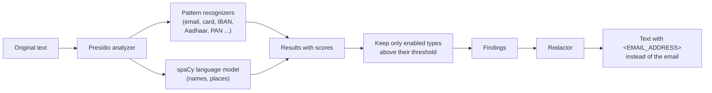

# Personal Data (PII) Detection

Phase 6 document. Written on 18 November 2026.

This phase adds the second detector: it finds **personal data** (PII) like emails, phone numbers, names, card numbers and ID numbers. It also adds the **redactor**, which hides what the detectors find. It covers requirements FR-15 to FR-19 from [01-project-requirements.md](01-project-requirements.md).

---

## 1. How it works



**How to read it**

The text goes into **Presidio**, Microsoft's open-source PII tool. Presidio runs two kinds of check at once:
- **Pattern recognizers** for data with a fixed shape, like emails or card numbers.
- The **spaCy language model** for names and places, which have no fixed shape.

Our code then keeps only the types turned on in the config, drops results below each type's threshold, and turns the rest into our own `Finding` objects. The **redactor** can then replace each finding with a label.

---

## 2. What Presidio does for us

### Pattern recognizers with checks

A pattern alone gives many false alarms. `1234 5678 9012 3456` *looks* like a card number. So Presidio also checks the numbers themselves:

| Data | Extra check | Example |
|---|---|---|
| Credit card | **Luhn checksum**, a simple maths check every real card number passes | `4111 1111 1111 1111` passes, `1234 5678 9012 3456` fails and is ignored |
| Aadhaar | **Verhoeff checksum**, the check digit used by Aadhaar | `2345 6789 0124` passes; change the last digit and it is ignored |
| IBAN | IBAN's own check digits | `GB82 WEST 1234 5698 7654 32` passes |
| US SSN | Rejects number ranges that are never issued | `078-05-1120`, a famous fake, is not reported as an SSN |
| Phone | Google's `phonenumbers` library checks the format for each country | `+91 98765 43210`, `(212) 555-0147` |

### The language model (NER)

Names and places have no fixed pattern, so Presidio uses **spaCy**, a language library, with its English model `en_core_web_lg`. The model does **Named Entity Recognition (NER)**: it reads the whole sentence and decides which words are a person, a place or an organisation. In "Dr. Anjali Mehta from Bengaluru called", it understands that "Anjali Mehta" is a person and "Bengaluru" is a place.

### Context words

Presidio raises a score when helpful words are nearby. A passport number like `J8369854` scores only **0.1** on its own (any 8-character code looks like that), but **0.45** when the word "passport" is close. We set the passport threshold to 0.4, so it only counts **with** that context.

### Scores

Every result has a score from 0 to 1. Strong pattern matches with a passing checksum score 1.0. Names and places found by spaCy always score 0.85. Phone numbers score 0.4 to 0.75, depending on how sure `phonenumbers` is.

---

## 3. The config file (`config/pii_entities.yaml`)

```yaml
version: 1
language: en
spacy_model: en_core_web_lg
phone_regions: [IN, US, GB, CA, AU, DE, FR]

entities:
  EMAIL_ADDRESS: { min_confidence: 0.5, severity: medium }
  PERSON:        { min_confidence: 0.85, severity: medium }
  IN_AADHAAR:    { min_confidence: 0.5, severity: critical }
  DATE_TIME:     { min_confidence: 0.85, severity: low, enabled: false }
  ...
```

| Field | Meaning |
|---|---|
| `min_confidence` | Results with a lower Presidio score are dropped. Raise it for fewer false alarms |
| `severity` | How serious a leak of this type is. The policy engine (Phase 9) will use this |
| `enabled` | `false` turns a type off without deleting the line |
| `phone_regions` | Which countries' phone formats to recognise |
| `spacy_model` | Which language model to use |

### Types we look for

| Group | Types | Severity |
|---|---|---|
| Contact details | `EMAIL_ADDRESS`, `PHONE_NUMBER` | medium |
| People and places | `PERSON` (medium), `LOCATION` (low) | low to medium |
| Money | `CREDIT_CARD`, `IBAN_CODE` (high), `CRYPTO` (medium) | medium to high |
| Indian IDs | `IN_AADHAAR` (critical), `IN_PAN`, `IN_PASSPORT` (high) | high to critical |
| Other IDs | `US_SSN` (critical), `US_PASSPORT`, `UK_NHS` (high) | high to critical |
| Network | `IP_ADDRESS` | low |
| **Turned off** | `DATE_TIME`, `US_BANK_NUMBER`, `URL`, `NRP` | too many false alarms |

**Why are some types turned off?** `DATE_TIME` matches "tomorrow" and "3pm". `US_BANK_NUMBER` matches almost any 8 to 17 digit number, like order numbers. In a chat gateway these would warn on nearly every message, and people would learn to ignore the warnings. Each can be turned back on with one line.

**Indian IDs.** Presidio has recognizers for Aadhaar, PAN and Indian passports, but does **not** load them by default. Our code adds them (requirement FR-17).

### Checks when loading

The config is checked with Pydantic, just like the injection rules. These are all caught with a clear `PIIConfigError`:
- wrong version or language
- a model name that is not a simple name (stops values like `../../evil`)
- phone regions that are not 2-letter codes
- lowercase entity names
- confidence of 0
- severity `none`
- misspelled fields
- every type turned off

**Entity names Presidio does not know** (a typo like `EMAIL_ADRESS`) are caught when the detector is created.

---

## 4. Two security fixes inside Presidio

While setting Presidio up, we found two places where it reaches out to the internet without asking. Both are now turned off, and each has a test.

### Fix 1: the email check downloaded a file

Presidio checks email domains with a library called `tldextract`. The first time it runs, `tldextract` **downloads** a list of web domains from `publicsuffix.org`. That means the first email scanned triggers an internet request. A security gateway should not make surprise network calls:
- it may run where there is no internet
- outgoing traffic is something security teams want to control

**Fix:** `_turn_off_domain_list_download()` tells `tldextract` to use the copy of the list that ships **inside** the package, and to write no cache files.

**Test:** `test_scanning_uses_no_internet` blocks every network connection, then scans an email. It still works.

### Fix 2: a missing model was downloaded and installed

If the spaCy model is missing, Presidio quietly runs `spacy.cli.download`, which **installs a package from the internet while the gateway is running**. That is a supply-chain risk: the gateway would be fetching and installing code on its own.

**Fix:** `build_analyzer()` checks whether the model is installed **before** Presidio starts. If not, it stops with a clear error:

```text
PIIConfigError: spaCy model 'en_core_web_lg' is not installed. Install it with: pip install -r requirements.txt
```

**Test:** `test_missing_model_is_not_downloaded` replaces the download function with one that fails the test if called.

**The lesson:** check what a library does by default, especially a security-related one. Both behaviours are convenient for a quick demo, but wrong for a gateway.

---

## 5. The redactor (hiding what was found)

`src/llm_gateway/dlp/redactor.py` replaces each finding with something safe. It works with findings from **any** detector, so PII now and secrets in Phase 7 are hidden the same way.

| Mode | Result | When to use it |
|---|---|---|
| `label` (default) | `Email me at <EMAIL_ADDRESS>` | The AI still understands an email was there, so answers stay sensible |
| `mask` | `Email me at *****************` | Same length; shows something was hidden |
| `remove` | `Email me at [REDACTED]` | Reveals nothing, not even the type |

### Overlapping findings

Sometimes two detectors find the same text. For example, `4111 1111 1111 1111` could be both a card and a phone number. The redactor:
1. sorts findings by position
2. **merges** findings that overlap into one span
3. uses the label of the **most confident** finding, so the card number becomes `<CREDIT_CARD>` once, not `<CREDIT_CARD><PHONE_NUMBER>`

Findings that only touch (one ends exactly where the next begins) stay separate, because they are two different items.

### How to use it

```python
from llm_gateway.dlp.redactor import redact, RedactionMode

text = "I'm Neha Kapoor, email neha.k@example.com"
findings = pii_detector.scan_text(text)
print(redact(text, findings))  # I'm <PERSON>, email <EMAIL_ADDRESS>
print(redact(text, findings, RedactionMode.REMOVE))  # I'm [REDACTED], email [REDACTED]
```

---

## 6. Design decisions

| Decision | Why |
|---|---|
| **Use Presidio, not our own NER** | Building name recognition from scratch would be worse and much more work. Presidio is maintained by Microsoft and widely used |
| **Use `en_core_web_lg` (about 400 MB), not the small model (12 MB)** | The large model recognises names more accurately. Memory and download size are acceptable for a server |
| **Pin the model to an exact file URL in `requirements.txt`** | Every install, including Docker in Phase 15, gets exactly the same model. It comes from spaCy's official GitHub releases |
| **Scan the original text, not the cleaned view** | The language model uses capital letters and punctuation to spot names. Lowercasing would make it worse |
| **Build the redactor now (planned for Phase 8)** | The Phase 6 brief asks for redaction. It is a small, separate module, so building it early changes nothing in the design |
| **Write our own redactor instead of using `presidio-anonymizer`** | Presidio's anonymizer only understands Presidio's own results. Ours works with findings from **every** detector (PII, secrets, and more), so there is one consistent way of hiding data, and one less package |
| **Load the model once and reuse it** | Loading takes 1 to 3 seconds and about 1 GB of memory. Tests share one detector through a session fixture |

---

## 7. Files added or changed

| File | What it does |
|---|---|
| `src/llm_gateway/detectors/pii.py` | Config loading, `build_analyzer()` with the two security fixes, and `PIIDetector` |
| `src/llm_gateway/dlp/redactor.py` | `redact()` with label, mask and remove modes, and overlap merging |
| `src/llm_gateway/detectors/base.py` | New `DetectorConfigError`, the shared parent of `RuleConfigError` and `PIIConfigError` |
| `config/pii_entities.yaml` | Which PII types to find, thresholds and severities |
| `requirements.txt` | Added `presidio-analyzer`, `spacy` and the pinned English model |
| `src/llm_gateway/settings.py`, `.env.example` | New setting `GATEWAY_PII_ENTITIES_FILE` |
| `scripts/check_env.py` | Now also checks Presidio, spaCy and the model |
| `pyproject.toml` | Long lines are allowed in `tests/data/` (sample sentences) |
| `tests/data/pii_samples.py` | 19 PII samples, 15 clean samples, 2 known false positives, 4 known misses |
| `tests/unit/test_redactor.py` | 12 tests |
| `tests/unit/test_pii_config.py` | 16 tests |
| `tests/integration/test_pii_detector.py` | 43 tests with the real model |
| `tests/security/test_pii_leaks.py` | 11 tests: no leaks after redaction, no internet, no downloads, speed, known limits |

### `pii.py` in more detail

- **`load_pii_config(path)`** reads the YAML with `yaml.safe_load` and checks it with the Pydantic models `PIIConfig` and `EntitySettings`.
- **`build_analyzer(config)`** turns off the domain list download, checks the model is installed, loads spaCy, loads Presidio's standard recognizers, swaps in a phone recognizer that knows our country list, and adds the Indian recognizers. **It is slow, so call it once.**
- **`PIIDetector.__init__`** builds the analyzer (or reuses one passed in; tests use this) and rejects unknown entity names.
- **`PIIDetector.scan`** sends the **original** text to Presidio, keeps results above each type's threshold, and returns findings with `detector="pii"`, `category="pii"`, the `entity_type` and the Presidio recognizer name as `rule_id`.

**How to use it:**
```python
from pathlib import Path
from llm_gateway.detectors.pii import PIIDetector

detector = PIIDetector.from_file(Path("config/pii_entities.yaml"))  # slow: once
for f in detector.scan_text("Call Rahul on +91 98765 43210"):
    print(f.entity_type, f.confidence)
```

**Common errors:**
- `PIIConfigError: spaCy model ... is not installed`: run `.\.venv\Scripts\python.exe -m pip install -r requirements.txt`.
- `PIIConfigError: Presidio does not know these entities: [...]`: there is a typo in `pii_entities.yaml`.
- Slow first scan: the model loads when the detector is **created**, not on the first scan. Create it once when the gateway starts.

---

## 8. Test results (18 November 2026)

### All tests

| Check | Result |
|---|---|
| pytest | **321 passed, 13 xfailed** (all 13 expected; see below) |
| By group | unit 164, integration 47, security 110 passed + 13 xfailed |
| Coverage | `pii.py` 98%, `redactor.py` 97%, whole package 98% |
| Ruff lint and format | Passed |
| mypy (strict) | Passed, 39 files |
| `check_env.py` | All required checks passed |

### Detection on our samples

| Measure | Result |
|---|---|
| PII samples where every expected type was found | **19 / 19** |
| Clean samples with no finding at all | **15 / 15** |
| PII samples where nothing personal remains after redaction | **19 / 19** |

As with Phase 5, **these are our own samples**, chosen to show the detector working. They are not proof of real-world accuracy. Phase 16 tests more independently.

### Speed

Median of 5 runs, on this laptop, after the model was loaded:

| Text length | PII detector | Injection detector |
|---|---|---|
| 200 characters | 10 ms | 0.4 ms |
| 2,000 characters | **63 ms** | 3 ms |
| 20,000 characters (the default limit) | 658 ms | 33 ms |

For a 2,000-character prompt, both detectors together take about **66 ms**, under the requirement of 150 ms (NFR-05). Loading the model takes 1 to 3 seconds and happens once, at startup.

---

## 9. Limitations

### Known false positives (flagged, but not really personal)

| Text | Why |
|---|---|
| "What is the capital of France?" | spaCy finds "France" as a place, even in a general question |
| "How tall is Mount Everest?" | Same: places are always reported |

`LOCATION` has **low** severity for this reason. The default policy (Phase 8) only warns for locations, never blocks.

> **Fixed in Phase 8:** the last 12 digits of a UUID (like `...-426614174000`) can pass the Aadhaar check digit by chance, and were reported as an Aadhaar number. Number-like IDs are now ignored when they are part of a longer token. See section 6 of [09-dlp-engine.md](09-dlp-engine.md).

### Known misses (personal data that is NOT found)

| Text | Why |
|---|---|
| "email me at priya dot sharma at example dot com" | Spelled-out emails have no `@`, so the email pattern does not match (only "sharma" is found as a name) |
| "nine eight seven six five four three two one zero" | Numbers written as words |
| "I live at 221B Baker Street" | **Presidio has no street address recognizer** for English. City and country names are found, street addresses are not |
| "4 1 1 1 1 1 1 1 ..." | A card number with a space between every digit |

All of these are kept as `xfail` tests, so they stay visible.

### Other limits
- **English only.** The model is English. Names in other scripts (Devanagari, for example) are usually not found.
- **Names are guessed from context.** Unusual names, or names that are also normal words ("Hope", "Faith"), can be missed or wrongly found.
- **Personal data spread over several messages** is not linked together.
- **The "requirement FR-16, addresses" goal is only partly met:** cities and countries yes, full street addresses no. A custom address recognizer could be added later.
- **Memory:** the model uses about 1 GB of RAM. That matters for Docker (Phase 15).

---

## 10. How to check it yourself

```powershell
cd "C:\Users\amanc\Desktop\LLM Security Guard New"

# All tests, or only the PII ones
.\.venv\Scripts\python.exe -m pytest
.\.venv\Scripts\python.exe -m pytest tests\integration\test_pii_detector.py tests\security\test_pii_leaks.py -v

# Try your own text (takes a few seconds to load the model)
.\.venv\Scripts\python.exe -c "from pathlib import Path; from llm_gateway.detectors.pii import PIIDetector; from llm_gateway.dlp.redactor import redact; d = PIIDetector.from_file(Path('config/pii_entities.yaml')); t = 'Hi, I am Rahul Verma, call me on +91 98765 43210'; print(redact(t, d.scan_text(t)))"
```

The last command should print: `Hi, I am <PERSON>, call me on <PHONE_NUMBER>`
