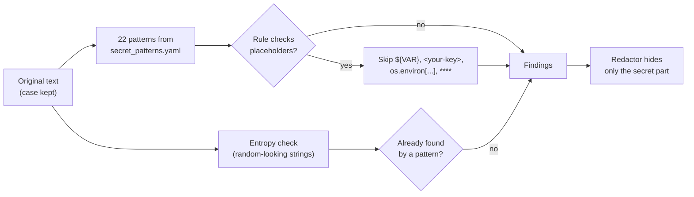

# Secret Detection

Phase 7 document. Written on 18 November 2026.

This phase adds the third detector: it finds **secrets** like API keys, access tokens, passwords and private keys. It covers requirements FR-20 to FR-24 from [01-project-requirements.md](01-project-requirements.md). Found secrets are hidden by the same redactor as personal data (Phase 6).

> **This document contains no real or realistic secrets.** Examples use placeholders like `<value>`. Our own repo scan (section 6) checks this file too.

---

## 1. How it works



**How to read it**

The text goes through two checks:
1. **Patterns** for known secret formats, like AWS keys or GitHub tokens, and for passwords written after a keyword like `password=`. Password rules skip obvious **placeholders**.
2. An **entropy check** for long random-looking strings in formats we have no pattern for. It skips anything a pattern already found.

The findings then go to the same redactor as PII.

**Patterns run on the original text**, not the lowercase cleaned view from Phase 5. Keys are case-sensitive: `AKIA` followed by 16 capitals is an AWS key, but the same text in lowercase is not.

---

## 2. What it finds

### Known key formats (high confidence)

Many services start their keys with a fixed **prefix**, which makes them easy to recognise:

| Service | What the key starts with | Type in findings | Confidence |
|---|---|---|---|
| AWS | `AKIA` (and `ASIA`, `ABIA`, `ACCA`) + 16 capitals/digits | `AWS_ACCESS_KEY_ID` | 0.95 |
| AWS | 40 characters after `aws_secret_access_key=` | `AWS_SECRET_ACCESS_KEY` | 0.9 |
| Google | `AIza` + 35 characters | `GOOGLE_API_KEY` | 0.9 |
| Azure | `AccountKey=` + 88 characters | `AZURE_STORAGE_KEY` | 0.9 |
| OpenAI | `sk-` ... containing the marker `T3BlbkFJ` | `OPENAI_API_KEY` | 0.95 |
| OpenAI | `sk-proj-`, `sk-svcacct-`, `sk-admin-` | `OPENAI_API_KEY` | 0.85 |
| Anthropic | `sk-ant-api03-` (and similar) | `ANTHROPIC_API_KEY` | 0.95 |
| Hugging Face | `hf_` | `HUGGINGFACE_TOKEN` | 0.9 |
| GitHub | `ghp_`, `gho_`, `ghu_`, `ghs_`, `ghr_`, `github_pat_` | `GITHUB_TOKEN` | 0.95 |
| npm | `npm_` | `NPM_TOKEN` | 0.9 |
| Slack | `xoxb-`, `xoxp-` ... and webhook URLs | `SLACK_TOKEN`, `SLACK_WEBHOOK` | 0.9 |
| Stripe | `sk_live_` / `rk_live_` (real money) | `STRIPE_SECRET_KEY` | 0.95 |
| Stripe | `sk_test_` (test mode) | `STRIPE_TEST_KEY` | 0.6 |
| SendGrid | `SG.` + two parts | `SENDGRID_API_KEY` | 0.95 |

**Fun fact:** `T3BlbkFJ` inside OpenAI keys is the word "OpenAI" in base64. It makes OpenAI keys very easy to recognise.

### Standard formats

| What | How it is recognised | Type | Confidence |
|---|---|---|---|
| Private keys | A `-----BEGIN ... PRIVATE KEY-----` line, the body, and the END line | `PRIVATE_KEY` | 0.99 |
| JSON Web Tokens | Three base64 parts separated by dots; the first two start with `eyJ` (base64 for `{"`) | `JWT` | 0.85 |
| Bearer tokens | The token after the word `Bearer` | `BEARER_TOKEN` | 0.8 |

### Passwords (lower confidence, with extra checks)

| What | Example shape | Type | Confidence |
|---|---|---|---|
| Password in a URL | `postgres://user:<value>@host` | `PASSWORD_IN_URL` | 0.9 |
| Password in config or code | `password=<value>`, `DB_PASSWORD: <value>`, `api_key = "<value>"` | `SECRET_ASSIGNMENT` | 0.75 |
| Password in a sentence | "My password is `<value>`" | `PASSWORD` | 0.7 |

### Unknown formats: the entropy check

| What | Type | Confidence |
|---|---|---|
| A string of 24+ characters with lowercase, uppercase **and** digits that looks random | `HIGH_ENTROPY_STRING` | **0.5** (warn only) |

---

## 3. Key ideas

### Only the secret part is hidden (`secret_group`)

For `password=<value>`, hiding the whole thing would lose useful context. A rule can say which **regex group** is the secret itself, so only that part is replaced:

```text
before:  DB_PASSWORD=<value>
after:   DB_PASSWORD=<SECRET_ASSIGNMENT>
```

The reader (and the AI) still knows *which* setting it was, without learning the secret.

### Placeholders are not secrets

Code and documentation are full of things that **look** like password assignments but are not real:

| Example | Why it is not a secret |
|---|---|
| `password = os.environ['DB_PASSWORD']` | Code that reads the real value from somewhere else |
| `password: ${DB_PASSWORD}` | An environment variable reference |
| `api_key=<your-api-key>` | A placeholder in documentation |
| `url = f"postgres://{user}:{db_pass}@{host}"` | A Python f-string |
| `Enter your password: ********` | Already masked |
| `password=changeme` | A well-known placeholder word |
| `if (password == confirmPassword)` | A variable name |

The rule file has a list of `placeholder_values`. If the **whole** value matches one of them, it is skipped. Only rules marked `check_placeholders: true` use this list. Key-format rules like the AWS one do not need it: a real key format is never a placeholder.

### Values must look like passwords (`require_mixed_chars`)

"My password is **strong**." matches the sentence pattern, but "strong" is a normal word. Password rules therefore require at least **two kinds** of character: lowercase, uppercase, digits, symbols. "strong" has one kind and is skipped. A value like `Tr0ub4dor` has three.

### Entropy: measuring randomness

**Shannon entropy** measures how unpredictable each character is, in bits:

```text
entropy = sum over each different character of  -p × log2(p)
          where p = how often that character appears / length
```

| String | Entropy (bits per character) |
|---|---|
| `aaaaaaaa` | 0 (completely predictable) |
| `abab` | 1 |
| English words | about 3 to 4 |
| a git commit hash (hex) | about 3.6 |
| random letters + digits | about 4.5 to 5 |

We report strings of 24 or more characters that have lowercase, uppercase **and** digits, and entropy of at least **4.3**. This skips git hashes and UUIDs (no uppercase), long variable names (no digits) and normal words.

The check is **noisy**: any random ID, for example a session ID or an encoded image, can trigger it. That is why its confidence is **0.5** (warn, not block), and it is skipped wherever a specific pattern already found something.

### Every match is reported, not just the first five

The injection detector stops after 5 matches per rule; that is enough to say "this is an attack". **Secrets are different**: each one has to be **hidden**, so stopping at five would let the sixth leak. The secret detector reports up to 500 per rule. A test pastes a "file" with 100 keys and checks that all 100 are hidden.

---

## 4. Keeping secrets out of our own repository

Your brief says: *never place real credentials in source code or GitHub*. We applied that to **fake** test secrets too.

### Why even fake secrets are a problem

Secret scanners cannot tell a realistic fake key from a real one. A file with a complete fake GitHub token would:
- possibly be **blocked** by GitHub's push protection
- trigger alarms in anyone else's scanner that looks at our public repo
- teach a bad habit

### How the test secrets are made

`tests/data/secret_samples.py` **builds** each fake secret when the tests run:

```python
_rng = random.Random(7608)  # fixed seed: same values every run

AWS_ACCESS_KEY_ID = "AK" + "IA" + _chars(16, UPPER_DIGITS)
GITHUB_TOKEN = "gh" + "p_" + _chars(36)
```

- The prefix is **split in two** (`"AK" + "IA"`), so the full format never appears in the source.
- The rest is **random characters with a fixed seed**, so the values are the same on every run and every computer, and tests are repeatable.
- None of the values work anywhere. They are random characters in the right shape.

---

## 5. Bugs the repo scan found in our own work

We pointed our own secret detector at our own project (section 6). Over several runs it found **24 problems**, including 4 in the first draft of this guide, and fixing them improved both the tests and the detector:

| What it found | What it really was | Fix |
|---|---|---|
| A `password=` example with a simple made-up value, in two code comments | Our own example text | Changed the examples to `<value>` |
| Variables like `URL_PASSWORD = "..." + "..."` | Fake test values, but named exactly like real hard-coded passwords | Renamed to `FAKE_URL_PASS` and similar |
| `api_key="{ANTHROPIC_KEY}"` in an f-string | **A real gap:** single-brace templates (`{name}`) were not treated as placeholders, so any pasted Python code with `f"Bearer {token}"` would raise false alarms | Added `{name}` to the placeholder list, plus tests |
| `GATEWAY_OPENAI_API_KEY=` (empty) in `.env.example` | **A real bug:** `\s*` after `=` also matches line breaks, so an empty value "borrowed" the **next line** as its value | Changed `\s*` to `[ \t]*` (spaces and tabs only) in 3 patterns, plus a regression test |
| A fake OpenAI key value in a Phase 4 settings test | A fake key shaped like a real one | Changed to `fake-openai-key-for-tests` |
| Markdown in **this guide**: "My password is" followed by a placeholder in backticks, and by a plain word in bold | **A real gap:** Markdown formatting around a value broke both checks. The backticks stopped `<value>` from matching the placeholder list, and the `*` in bold counted as a symbol for the mixed-characters check | The detector now trims Markdown wrappers (`` ` ``, `*`, `_`, `~`) from the edges of a value before checking it, and shrinks the hidden span to match, plus tests |

Three of these were **real detector gaps** that would have caused false alarms for real users, and prompts and AI answers are full of Markdown. Testing a security tool on your own code is a cheap way to find problems early.

---

## 6. The repo scan (`tests/security/test_no_secrets_in_repo.py`)

On **every test run**, this test:
1. asks Git for every tracked file plus new files that are not ignored (`git ls-files --cached --others --exclude-standard`)
2. scans each text file with the secret detector
3. fails if anything with confidence **0.7 or more** is found

Entropy findings (0.5) are allowed, because documents contain things like example base64 strings.

The failure message shows the **file, line and rule, but never the secret itself**, so a real secret would not be copied into test logs:

```text
possible secrets found:
  config/example.yaml:12 secret-assignment (SECRET_ASSIGNMENT)
```

If Git is not available (for example inside a Docker image without the `.git` folder), the test is skipped instead of failing.

---

## 7. Files added or changed

| File | What it does |
|---|---|
| `config/secret_patterns.yaml` | 22 patterns, the placeholder list and the entropy settings |
| `src/llm_gateway/detectors/secrets.py` | Pattern file loading and checking, `shannon_entropy()`, `character_kinds()` and `SecretDetector` |
| `src/llm_gateway/settings.py`, `.env.example` | New setting `GATEWAY_SECRET_PATTERNS_FILE` |
| `tests/data/secret_samples.py` | 26 fake secrets built at runtime, 29 clean samples, 4 known misses |
| `tests/unit/test_secret_rules.py` | 19 tests for loading and checking the pattern file |
| `tests/unit/test_secret_detector.py` | 45 tests: every rule used, placeholders, Markdown, entropy, mixed characters, 100 keys in one text |
| `tests/security/test_secret_leaks.py` | 67 tests: every secret found and hidden in all 3 redaction modes, clean text, known misses, slow inputs |
| `tests/security/test_no_secrets_in_repo.py` | Scans our own project for secrets |
| `tests/unit/test_settings.py` | The fake key value changed (section 5) |

### `secrets.py` in more detail

- **`SecretRule`** checks each rule when it is loaded: the regex compiles, `secret_group` exists in the pattern, `secret_type` is UPPER_CASE, and severity is not `none`.
- **`SecretRuleSet`** checks the whole file: no duplicate ids, at least one rule enabled, every placeholder pattern compiles. It joins all placeholders into one regex for speed. `is_placeholder(value)` tests whether the **whole** value matches.
- **`SecretDetector.scan()`** runs each pattern on the original text, takes the `secret_group` span, skips placeholders and too-simple values where the rule asks for it, then runs the entropy check on anything not already found.

**How to use it:**
```python
from pathlib import Path
from llm_gateway.detectors.secrets import SecretDetector
from llm_gateway.dlp.redactor import redact

detector = SecretDetector.from_file(Path("config/secret_patterns.yaml"))
text = "DB_PASSWORD=<paste something here>"
print(redact(text, detector.scan_text(text)))
```

**How to add a pattern:**
1. Add it to `config/secret_patterns.yaml`. Use `[ \t]*`, not `\s*`, between a keyword and its value.
2. Add a **built-at-runtime** fake example to `SECRET_SAMPLES` in `tests/data/secret_samples.py`. `test_every_rule_is_used_by_a_sample` fails if a rule has no sample.
3. Run the tests. The repo scan will tell you if you accidentally wrote a real-looking secret.

**Common errors:**
- `SecretConfigError: ... secret_group is 1 but the pattern only has 0 group(s)`: add `( )` around the secret part of the pattern.
- `... is not valid YAML: mapping values are not allowed here`: a description containing `: ` needs quotes. This happened while writing this phase.
- A placeholder is reported as a secret: add its shape to `placeholder_values`.

---

## 8. Test results (18 November 2026)

| Check | Result |
|---|---|
| pytest | **449 passed, 17 xfailed** (all expected) |
| By group | unit 228, integration 47, security 174 passed + 17 xfailed |
| Coverage | `secrets.py` 100%, `redactor.py` 100%, whole package 99% |
| Ruff lint and format | Passed |
| mypy (strict) | Passed, 45 files |
| Repo scan | No secrets in our own project |
| Phase 5 injection results | Unchanged (48/48 detected, 41/48 blocked, 2/50 false blocks) |

### Detection on our samples

| Measure | Result |
|---|---|
| Fake secrets found with the right type | **26 / 26** |
| Fake secrets fully hidden (label, mask **and** remove modes) | **26 / 26** |
| All 26 pasted together in one message, then hidden | none left |
| Clean samples with no finding | **29 / 29** |
| Every one of the 22 patterns used by at least one sample | yes |

Same warning as before: **these are our own samples**. Phase 16 tests more independently.

### Speed

Median of 5 runs, on this laptop:

| Text length | Secret detector |
|---|---|
| 200 characters | 0.3 ms |
| 2,000 characters | **2.7 ms** |
| 20,000 characters | 30 ms |

All three detectors together, for 2,000 characters: about **3 ms (injection) + 63 ms (PII) + 3 ms (secrets) ≈ 69 ms**, still under the 150 ms requirement (NFR-05). Seven crafted slow inputs (1,200 key headers without an END line, 60,000 repeated characters and more) each finish well under the 2-second limit.

---

## 9. Limitations

### Known misses (kept as `xfail` tests)

| Example | Why it is missed |
|---|---|
| "the wifi code is `<word-word-number>`" | No keyword we know ("code" is not on the list, because it appears everywhere) |
| An AWS key broken up with spaces | Patterns expect the key in one piece |
| "mot de passe : `<value>`" | Keywords are English only |
| A short custom token with no known prefix and low randomness | No pattern, and too short or too regular for the entropy check |

### Other limits

- **New key formats need new patterns.** A service we have no pattern for is only caught by the entropy check, and only if its keys are long, mixed-case and random.
- **Hex-only secrets are missed by the entropy check.** Some services use lowercase hex keys. They look exactly like git hashes, so we skip them to avoid constant false alarms.
- **The entropy check is noisy.** Random IDs, encoded images and long base64 strings can trigger it, which is why it only warns.
- **Placeholders can hide weak real passwords.** `password=changeme` is skipped as a placeholder, even though some systems really use it.
- **A secret only partly in the text** (cut off at the start or end) usually does not match its pattern.
- **We do not check whether a key is live.** Some tools call the provider to test a key. We do not, on purpose: the gateway must never send a secret anywhere.

---

## 10. How to check it yourself

```powershell
cd "C:\Users\amanc\Desktop\LLM Security Guard New"

# All tests, or only the secret ones
.\.venv\Scripts\python.exe -m pytest
.\.venv\Scripts\python.exe -m pytest tests\unit\test_secret_detector.py tests\security\test_secret_leaks.py -v

# Scan this project for secrets
.\.venv\Scripts\python.exe -m pytest tests\security\test_no_secrets_in_repo.py -v

# Try a placeholder and a fake value (both made up on the spot)
.\.venv\Scripts\python.exe -c "from pathlib import Path; from llm_gateway.detectors.secrets import SecretDetector as S; from llm_gateway.dlp.redactor import redact; d = S.from_file(Path('config/secret_patterns.yaml')); [print(redact(t, d.scan_text(t))) for t in ['password=${DB_PASS}', 'pass' + 'word=Blue' + 'Sky99!']]"
```

The last command should print `password=${DB_PASS}` (a placeholder, left alone) and then `password=<SECRET_ASSIGNMENT>`.
