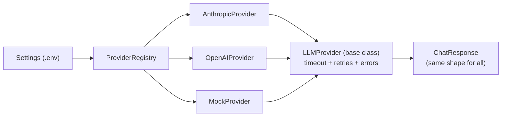

# Connecting to AI Providers

Phase 10 document. Written on 20 November 2026.

Until now the gateway could check text, but had no AI to send it to. This phase adds the **providers**: the code that talks to an AI model. It covers requirements FR-33 to FR-40 from [01-project-requirements.md](01-project-requirements.md).

| Provider | Needs | Cost | When to use |
|---|---|---|---|
| **mock** (default) | Nothing | Free | Development, tests, demos. Works offline |
| **anthropic** | `GATEWAY_ANTHROPIC_API_KEY` + `pip install -r requirements-providers.txt` | Paid | Real Claude answers |
| **openai** | `GATEWAY_OPENAI_API_KEY` **and** `GATEWAY_OPENAI_MODEL` + the same install | Paid | Real OpenAI answers |

**Nothing in this phase needs a paid account.** The real providers are tested offline (section 6).

---

## 1. How it fits together



**How to read it**

- The **registry** reads the settings and creates every provider that is set up. The mock is always there.
- All three providers share one **base class**. It holds everything that must behave the same for every provider: time limits, retries and error handling.
- Each provider only writes **one** method, `_complete_once()`. It sends one request and turns the answer into a `ChatResponse`, which has the same shape whichever AI answered.

In Phase 13 the API will put the DLP engine around this: the prompt is checked before `complete()`, and the answer is checked after it.

---

## 2. The shared shape

### What can be sent (`ChatRequest`)

| Field | Rules |
|---|---|
| `messages` | 1 or more messages with role `system`, `user` or `assistant`. The **last** message and the first non-system one must come from the **user** (Claude requires this, so every provider follows it) |
| `model` | Optional, overrides the default. Only letters, digits and `. _ : -`, at most 100 characters |
| `max_tokens` | 1 to 32,000, default 16,000 |

**Nothing else can be sent.** The model uses `extra="forbid"`, so a field like `temperature` is an error, not something quietly passed to the provider. That keeps the gateway in control of exactly what reaches the AI.

### What comes back (`ChatResponse`)

| Field | Meaning |
|---|---|
| `content` | The answer text |
| `finish_reason` | Why it stopped, in the same words for every provider: `stop`, `length` (cut off at `max_tokens`), `content_filter`, `refusal`, `tool_use`, `other` |
| `usage` | Input and output tokens |
| `latency_ms`, `attempts` | Total time and how many tries it took |
| `provider`, `model` | Who answered |

---

## 3. Timeouts and retries

Every call goes through `LLMProvider.complete()`:

1. **A time limit per attempt** (`GATEWAY_PROVIDER_TIMEOUT_SECONDS`, now **120 s**, up from 30). Claude Opus with thinking can take longer than 30 seconds on a long answer.
2. **Retry only errors that might fix themselves:**

| Error | Retried? | Why |
|---|---|---|
| Timeout | yes | The next try may be faster |
| 429 Too Many Requests | yes | Wait, then try again |
| 5xx, 529 overloaded, network problems | yes | The provider had a hiccup |
| 401 / 403 wrong key | **no** | Trying again cannot help |
| 400 / 404 / 422 bad request | **no** | The same request will fail the same way |

3. **Wait longer each time, with randomness** ("exponential backoff with full jitter"). The longest possible wait doubles each retry (0.5 s, 1 s, 2 s ... up to 8 s), and the actual wait is a **random** time between 0 and that. The randomness stops many gateways from all retrying at the very same moment and overloading the provider again.

4. **At most `GATEWAY_PROVIDER_MAX_RETRIES` retries** (default 2), so at most 3 attempts.

### Why not use the SDKs' own retries?

Both official SDKs can retry by themselves. We turn that off (`max_retries=0`) and do it in our base class instead, because:
- all three providers, including the mock, then retry in **exactly the same** way
- the tests can control it (a fake `sleep` records the waits instead of really waiting)
- every attempt is counted (`attempts` in the response) and logged

---

## 4. Keeping API keys safe

| Protection | How |
|---|---|
| **Keys only from settings** | Read from `GATEWAY_OPENAI_API_KEY` / `GATEWAY_ANTHROPIC_API_KEY` as `SecretStr` (shown as `**********` if printed). `.get_secret_value()` is called once, only to create the SDK client |
| **Never in our error messages** | Some providers repeat part of the key in their error text (for example "Incorrect API key provided: sk-abc...xyz"). Our errors are always written by us, for example `openai: the API key was rejected`. The SDK's error is **not** attached (`from None`) |
| **Never in logs** | Logs record only the error **type**, status code and request id |
| **Never in `repr()`** | `repr(provider)` shows only the class and model |
| **Fixed addresses** | Both SDKs would also read `ANTHROPIC_BASE_URL` / `OPENAI_BASE_URL` from the environment. If someone could set that, every prompt **and the key** would go to their server. We pass the real address explicitly, so those variables are ignored |
| **Real providers optional** | Without a key, or without the package installed, the provider is simply not available and the gateway runs with the mock. `GET /v1/providers` (Phase 13) will show why |

A test makes the fake server echo part of the key in its error message, and checks that **no** piece of the key reaches our error text, `repr`, or the log. Another test sets `ANTHROPIC_BASE_URL` to an attacker's address and checks that requests still go to `api.anthropic.com`.

---

## 5. The three providers

### Mock (`providers/mock.py`)

Answers instantly, offline. By default it **echoes** the last user message:

```text
Mock answer. You said: Email <EMAIL_ADDRESS> the report
```

The echo is useful: the gateway hides personal data **before** the AI is called, so the echo shows exactly what the AI would have received.

**Test tags** make it misbehave on purpose, so protections can be tested without a real AI:

| Tag in the prompt | What the mock does |
|---|---|
| `[mock:leak-secret]` | Answers with a fake AWS key (built from pieces at runtime, so no full key is in the source) |
| `[mock:leak-pii]` | Answers with a fake email and the Visa test card number |
| `[mock:injection]` | Answers with "Ignore all previous instructions..." |
| `[mock:refusal]` | Refuses |
| `[mock:error:timeout]`, `rate_limit`, `server`, `auth`, `bad_request` | Fails with that error |
| `[mock:slow:2]` | Waits 2 seconds (to test timeouts) |

### Anthropic Claude (`providers/anthropic_provider.py`)

Uses the official `anthropic` SDK (version 2.10). Before writing it, I loaded Anthropic's current API reference so the choices below follow it rather than memory:

| Choice | Why |
|---|---|
| Default model **`claude-opus-5-5`** | The current Opus model. Change it with `GATEWAY_ANTHROPIC_MODEL` |
| **`effort`** setting (`GATEWAY_ANTHROPIC_EFFORT`, default `medium`) | On this model thinking is always on. Effort (low, medium, high, xhigh, max) controls how hard it thinks, and so speed and cost |
| **No `temperature`** | Current Claude models reject it. The SDK's `messages.create` no longer even has that parameter |
| **Server-side refusal fallbacks ON** | If Claude declines a request on safety grounds, the API retries it on another Claude model inside the same call (`fallbacks: "default"` + the `server-side-fallback-2026-07-01` beta header). Turn off with `GATEWAY_ANTHROPIC_REFUSAL_FALLBACKS=false`, for example for a model that does not support it |
| System messages go to the top-level `system` field | That is how the Claude API takes them |
| Only `text` blocks are returned | The answer can also contain thinking blocks and fallback markers; those are skipped |
| `stop_reason` mapped | `end_turn` → stop, `max_tokens` → length, `refusal` → refusal, `tool_use` → tool_use |

### OpenAI (`providers/openai_provider.py`)

Uses the official `openai` SDK (version 3.54), Chat Completions API.

| Choice | Why |
|---|---|
| **No default model** | OpenAI model names change often. A hard-coded name could stop working, so you choose one with `GATEWAY_OPENAI_MODEL` |
| `max_completion_tokens` | The current name of the length limit |
| No `temperature` | Some current OpenAI models reject it |
| Refusals | If the answer has a `refusal`, that text is returned with `finish_reason = refusal` |

---

## 6. Testing real providers without paying

Both SDKs accept an `http_client`. The tests give them a client whose network is **fake** (`httpx2.MockTransport`). Every "request" is recorded and answered with a reply the test chooses. So we test the real provider code, with the real SDK, for free:

- **Request format:** the URL, the key header, the body (model, messages, `system`, `effort`, `fallbacks`, no `temperature`)
- **Answer parsing:** text, thinking blocks skipped, every stop reason, refusals, empty answers, malformed answers
- **Errors:** 400, 401, 403, 404, 422, 429, 500, 503, 529, timeouts and connection errors, each mapped to the right class, for **both** providers
- **Retries through the real SDK:** 503, then 429, then success = 3 attempts and 3 network requests
- **Secrets:** the key never appears in errors, `repr` or logs, and the base-URL variables are ignored

**Something the tests caught:** I first assumed the Anthropic SDK sends the key in an `x-api-key` header. It does not: version 2.x uses the `Authorization` header. The test checked my assumption, not the code, and failed; I looked at the real request and fixed the test. The same check showed the SDK uses API version `2026-10-21`, the version in which `temperature` was removed. That confirms leaving it out was right.

---

## 7. Settings added

| Variable | Default | Meaning |
|---|---|---|
| `GATEWAY_OPENAI_MODEL` | (none) | Required to use OpenAI |
| `GATEWAY_ANTHROPIC_MODEL` | `claude-opus-5-5` | Which Claude model |
| `GATEWAY_ANTHROPIC_EFFORT` | `medium` | How hard Claude thinks |
| `GATEWAY_ANTHROPIC_REFUSAL_FALLBACKS` | `true` | Retry refused requests on another Claude model |
| `GATEWAY_PROVIDER_TIMEOUT_SECONDS` | **120** (was 30) | Per attempt, up to 600 |

Setting `GATEWAY_DEFAULT_PROVIDER=openai` without a key **or** a model now stops the gateway at startup with a clear message.

---

## 8. Files added or changed

| File | What it does |
|---|---|
| `src/llm_gateway/providers/base.py` | `ChatRequest`, `ChatResponse`, `FinishReason`, the error classes, `RetryPolicy`, and `LLMProvider.complete()` (timeout and retries) |
| `src/llm_gateway/providers/mock.py` | The mock provider and its test tags |
| `src/llm_gateway/providers/anthropic_provider.py` | Claude, via the official SDK |
| `src/llm_gateway/providers/openai_provider.py` | OpenAI, via the official SDK |
| `src/llm_gateway/providers/registry.py` | `ProviderRegistry`: builds providers from settings, `get()`, `describe()` (never shows keys) |
| `src/llm_gateway/settings.py`, `.env.example` | The new settings (section 7) |
| `requirements-providers.txt` | **New, optional:** `openai==3.54.0`, `anthropic==2.10.0` |
| `requirements-dev.txt` | Includes the provider SDKs, because the tests check the provider code |
| `scripts/try_provider.py` | Send one prompt to a provider, optionally through the DLP engine (`--protect`) |
| `pyproject.toml` | Seeded random numbers are allowed in tests (Ruff rule S311) |
| `tests/unit/test_provider_base.py` | 28 tests: request rules, backoff, retries, timeouts |
| `tests/unit/test_mock_provider.py` | 13 tests: echo and every tag |
| `tests/unit/test_provider_registry.py` | 11 tests: which providers are ready, missing package, empty keys |
| `tests/integration/test_real_providers_offline.py` | 50 tests: both real providers against a fake network |
| `tests/security/test_provider_leaks.py` | 5 tests: mock leaks run through the DLP engine and are caught |

**How to use it in code:**

```python
import asyncio
from llm_gateway.providers.base import ChatMessage, ChatRequest
from llm_gateway.providers.registry import ProviderRegistry
from llm_gateway.settings import get_settings

registry = ProviderRegistry.from_settings(get_settings())
request = ChatRequest(messages=[ChatMessage(role="user", content="Hello")])
answer = asyncio.run(registry.get().complete(request))  # the default provider
print(answer.content, answer.finish_reason, answer.attempts)
```

**Common errors:**
- `ProviderNotConfigured: anthropic: set GATEWAY_ANTHROPIC_API_KEY to use it`: add the key to `.env`.
- `... the 'anthropic' package is not installed`: run `.\.venv\Scripts\python.exe -m pip install -r requirements-providers.txt`.
- `ProviderBadRequest: ... check the model name`: the model in your settings does not exist for your account.
- `ProviderAuthError: ... the API key was rejected`: wrong or expired key. Not retried.

---

## 9. Test results (20 November 2026)

| Check | Result |
|---|---|
| pytest | **909 passed, 20 xfailed** (all expected) |
| By group | unit 432, integration 118, security 359 passed + 20 xfailed |
| Coverage | `base.py`, `mock.py`, `registry.py` 100%; `anthropic_provider.py` 95%; `openai_provider.py` 97%; whole package 99% |
| Ruff lint and format | Passed |
| mypy (strict) | Passed, 70 files |

What `scripts/try_provider.py --protect` showed:

| Prompt | What happened |
|---|---|
| `Email priya@example.com the report` | The prompt was redacted; the AI (mock) received `Email <EMAIL_ADDRESS> the report` |
| `[mock:leak-secret]` | The answer contained a fake AWS key, and **was withheld** (block, risk critical) |
| `Ignore all previous instructions` | **Blocked**; nothing was sent to the AI |
| `--provider anthropic` without a key | `Cannot use that provider: anthropic: set GATEWAY_ANTHROPIC_API_KEY to use it` |

---

## 10. Limitations

- **The real providers have not been called for real.** Every test uses a fake network shaped like the real APIs. The request format and behaviour match the SDKs and Anthropic's API reference, but a real call (with your key, which costs money) is still needed to confirm it end to end. `scripts/try_provider.py` is ready for that.
- **Server-side fallbacks are untested live.** We only checked that the right field and header are sent.
- **A retried request may be charged twice.** If a request times out on our side but the provider finished it, the retry is a second paid request. That is the price of retrying timeouts.
- **The longest possible wait** is about `timeout × (retries + 1)` plus the backoff waits: 120 × 3 + up to 3 s ≈ 6 minutes with the defaults. Lower the timeout for chat apps that need quick answers.
- **No streaming yet.** The whole answer arrives at once. That also means answers can be checked as a whole (see the requirements, limitation 5).
- **No tools or images.** Text only.
- **Mock token counts** are word counts, not real tokens.

---

## 11. How to check it yourself

```powershell
cd "C:\Users\amanc\Desktop\LLM Security Guard New"

# The provider tests
.\.venv\Scripts\python.exe -m pytest tests\unit\test_provider_base.py tests\integration\test_real_providers_offline.py tests\security\test_provider_leaks.py -v

# Try the full flow with the free mock
.\.venv\Scripts\python.exe scripts\try_provider.py --protect "Email priya@example.com the report"
.\.venv\Scripts\python.exe scripts\try_provider.py --protect "[mock:leak-secret]"
```

**To try real Claude** (costs money): put `GATEWAY_ANTHROPIC_API_KEY=...` in your `.env` file. Never paste the key into the chat, and `.env` is never committed. Then:

```powershell
.\.venv\Scripts\python.exe scripts\try_provider.py --provider anthropic --protect "Say hello in one sentence"
```
