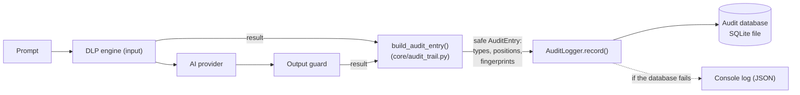

# Audit Logging

Phase 12 document. Written on 20 November 2026.

This phase gives the gateway a memory. Every request now leaves a **record** in a database: what was found, what was decided, which policy decided it and how long it took. The record never holds the prompt, the answer or any secret value. It covers requirements FR-44 to FR-48 and NFR-04 from [01-project-requirements.md](01-project-requirements.md), and threat I3 ("real secrets end up in logs") from [03-threat-model.md](03-threat-model.md).

---

## 1. Why keep an audit log?

| Question an admin will ask | Answered by |
|---|---|
| "Was anything blocked today, and why?" | Search by time, risk and decision |
| "Is someone attacking us?" | Count of injection findings per day |
| "Did this AWS key leak more than once?" | The same **fingerprint** in several events |
| "Why was this request blocked last month, when the rules were different?" | Each event names its **policy version**, and every version is kept |

A security tool that cannot explain its decisions is hard to trust. But a log is also a **new place where data can leak**. If the log saved prompts, it would become the biggest collection of secrets in the company. So most of this phase is about what the log **does not** keep.

---

## 2. How it works



**How to read it**

1. The prompt and the answer are checked as before (Phases 8 and 11).
2. `build_audit_entry()` turns both results into one **`AuditEntry`**. This is the only place where the prompt and answer are still around. They are used to make a fingerprint of each found value, and then they are dropped.
3. `AuditLogger.record()` saves the entry. If the database is down, the same safe entry goes to the console log instead (section 6).

The API (Phase 13) will run these steps for every request. For now, `scripts/audit_tool.py demo` runs them with the mock AI.

---

## 3. What is saved, and what is not

| Saved | Never saved |
|---|---|
| Request id, time, app (client) id | The prompt |
| Provider and model | The answer |
| Decision for the prompt and for the answer | The value of any secret, PII or confidential term |
| Overall risk level and how the request ended (`status`) | Plain hashes of those values |
| Lengths of the prompt and answer | Provider error messages (only the error type) |
| Time spent checking, at the AI, and in total | |
| Policy version that decided | |
| Per finding: detector, type, rule, confidence, severity, **position**, **fingerprint** | |

A record says "an AWS key was found in the answer at characters 20 to 40, fingerprint `fp_d8cd...`". It never says what the key was.

**This is enforced by the shape of the code, not by being careful.** `AuditEntry` has no field for the prompt, the answer or a value, so there is nowhere to put them by mistake. A test checks that no field or table column with a name like `prompt`, `answer`, `content`, `value` or `text` is ever added. The only two exceptions are below.

### The two text columns

- **`redacted_prompt`** is empty by default. If an admin sets `GATEWAY_STORE_REDACTED_PROMPTS=true`, it keeps the **redacted** prompt (the one sent to the AI, with findings replaced by labels like `<EMAIL_ADDRESS>`). A blocked prompt is never kept, even with this turned on. See the warning in section 10.
- **`policy_yaml`** in the policy table keeps the full policy text. Policies contain rules, not user data.

---

## 4. Fingerprints

A fingerprint is a short one-way code made from a found value:

```text
"priya@example.com"  ->  fp_3c9a1f0e8b7d6a52
```

- The **same value always gives the same fingerprint**. That links requests: the dashboard can show that one email appeared in the prompt of request 1 and in the AI's answer to request 7.
- It **cannot be turned back** into the value.

**Why HMAC with a secret key, and not a plain SHA-256 hash?** Many values are easy to guess. An Aadhaar number has 12 digits, about a trillion possibilities, and one gaming graphics card can hash all of them in minutes. With a plain hash, anyone who reads the database could find the number by trying them all. An **HMAC** mixes in a secret key (`GATEWAY_FINGERPRINT_KEY`) that is never stored in the database, so without the key, guessing is useless. A test checks that no plain SHA-256 of a sensitive value appears in the database file.

- The key must be at least **32 characters**. Production refuses to start without one. Make one with:
  ```powershell
  .\.venv\Scripts\python.exe -c "import secrets; print(secrets.token_hex(32))"
  ```
- Without a key (development only), a random key is used and a warning is logged. Fingerprints then change after every restart.
- A fingerprint is 16 hex characters (64 bits): plenty to tell values apart, short enough to read.

---

## 5. The database

### Tables

The four tables from section 8 of the architecture doc (`audit/tables.py`):

| Table | One row per | Notes |
|---|---|---|
| `audit_event` | request | Indexes on time, risk and client, for the dashboard filters |
| `finding_record` | finding | Linked to its event; deleted with it |
| `policy_version` | policy version | Never overwritten (section 7) |
| `api_client` | app that uses the gateway | Created now, filled in Phase 13 (logins); stores key **hashes** only |

### SQLite now, PostgreSQL later

Development uses **SQLite**: one file, `data/gateway.db`, created automatically, nothing to install. The `data/` folder is in `.gitignore`. For production, set `GATEWAY_DATABASE_URL` to a PostgreSQL address. The code stays the same, because **SQLAlchemy** handles the differences.

Two SQLite details that matter:
- SQLite **ignores foreign keys** unless you turn them on for every connection. Without this, a finding could point to an event that does not exist. `database.py` turns them on, and a test checks it.
- SQLite **forgets timezones**. A small `UTCDateTime` type saves every time in UTC and gives it back marked as UTC. A time without a timezone is refused, so a "local time" bug cannot creep in.

### Migrations (Alembic)

The tables are not made with a quick `create_all()`. They are made by an **Alembic migration**: a numbered script (`audit/migrations/versions/v0001_create_audit_tables.py`) that says exactly how to create them, and how to undo that.

**Why bother?** Later phases will change the tables, for example by adding a column. With migrations, a database made today can be **upgraded** later without losing its data. `create_all()` can only create tables that do not exist yet; it never changes old ones.

- The gateway upgrades its database by itself at startup (`build_audit()`).
- A test compares the migrations with `tables.py`. If someone changes a table and forgets the migration, the test fails.
- `alembic.ini` lets you run Alembic by hand (examples in section 11). The database address is **not** in that file. It comes from `GATEWAY_DATABASE_URL`, so a password can never be committed by accident.

---

## 6. When the database fails

The gateway should not stop protecting people just because logging broke. So by default, when a record cannot be saved:

1. the same safe record is written to the **console log** (as JSON, section 8)
2. the failure is **counted** (`failed_writes`, shown in the stats)
3. the request **carries on**

Some companies must have a record of every request. For them, `GATEWAY_AUDIT_REQUIRED=true` turns a failed write into an `AuditWriteError`, and the API (Phase 13) will answer **503** instead of serving a request it could not record.

Only the **type** of the database error is logged (for example `OperationalError`), never its message. Database error messages can quote the values that failed to save.

---

## 7. Policy history in the database

In Phase 9 the policy history lived in memory and started again at version 1 after every restart. Now every version is also saved to the `policy_version` table:

| Situation | What happens |
|---|---|
| First start | The policy file becomes version 1 and is saved |
| Restart, policy file **unchanged** | Still version 1 (same checksum). Nothing new is saved |
| Restart, policy file **changed** | Version 2 is saved and becomes active; version 1 stays |
| An admin updates the policy | A new version, saved with **who** made it |
| Two versions with the same number but different text | Refused: history is never overwritten |

So every audit event's `policy_version` points to a row that really exists, even years and many restarts later.

**The order of steps matters.** A new version is first saved to the database, then written to the policy file, and only then made active. If saving fails, nothing changes and the old version stays active. Otherwise the gateway could make decisions with a policy that has no record.

To make this possible without `policy/` knowing about the database, `PolicyStore` gained two optional arguments: `on_change` (called with each new version before it becomes active) and `resume` (the newest saved version, so numbering carries on). `core/factory.py` connects them to the database.

---

## 8. JSON logs

Normal log lines are written for people. JSON lines are just as readable, and log tools (Docker, Grafana Loki, Elasticsearch) can search them by field:

```json
{"time": "2026-11-20T10:15:02.123Z", "level": "ERROR", "logger": "llm_gateway.audit.logger", "message": "Audit record could not be saved to the database (OperationalError); the safe record follows", "audit_event": {"request_id": "req-1", "...": "..."}}
```

`audit/json_logging.py` has the formatter and `configure_logging()`. The API will turn it on at startup in Phase 13.

---

## 9. Searching, statistics and cleanup

`AuditLogger` can also read the log (FR-48). The API endpoints `GET /v1/events` and `/v1/stats` (Phase 13) will use these:

| Method | What it does |
|---|---|
| `search(EventFilter(...))` | Events, newest first. Filters: time range, minimum risk, decision (prompt **or** answer), finding type, app, status. 50 per page by default, never more than 500 |
| `count(...)` | How many events match, for page numbers |
| `get(request_id)` | One event with its findings |
| `stats(since=...)` | Counts by status, risk, decision and finding type |
| `delete_older_than(days)` | Deletes old events and their findings (NFR-04) |

**Deleting old events is part of privacy.** A log kept forever is a log that can leak forever. The default is 30 days (`GATEWAY_LOG_RETENTION_DAYS`). For now, run the cleanup with `audit_tool.py purge`. Phase 13 will run it automatically.

---

## 10. Files added or changed

| File | What it does |
|---|---|
| `src/llm_gateway/audit/tables.py` | **New.** The four tables and the `UTCDateTime` type |
| `src/llm_gateway/audit/records.py` | **New.** `AuditEntry` and `FindingEntry`: the safe record format |
| `src/llm_gateway/audit/fingerprint.py` | **New.** HMAC fingerprints |
| `src/llm_gateway/audit/logger.py` | **New.** `AuditLogger`: save, search, count, stats, cleanup, console fallback |
| `src/llm_gateway/audit/policy_history.py` | **New.** Saves policy versions |
| `src/llm_gateway/audit/database.py` | **New.** Connects, turns on SQLite foreign keys, runs migrations |
| `src/llm_gateway/audit/json_logging.py` | **New.** JSON log formatter |
| `src/llm_gateway/audit/migrations/` | **New.** Alembic setup and the first migration |
| `src/llm_gateway/core/audit_trail.py` | **New.** `build_audit_entry()` |
| `src/llm_gateway/core/factory.py` | `build_audit()`; `build_dlp_engine(..., policy_history=...)` |
| `src/llm_gateway/policy/store.py` | `on_change`, `resume`, and the exact policy text in each version |
| `src/llm_gateway/settings.py`, `.env.example` | `GATEWAY_AUDIT_REQUIRED`; the fingerprint key must be 32+ characters |
| `requirements.txt` | SQLAlchemy 2.1.9 and Alembic 1.20.1 |
| `alembic.ini` | **New.** For running Alembic by hand |
| `scripts/audit_tool.py` | **New.** Look at the audit log from the command line |
| `pyproject.toml` | Coverage skips the migration files (they are tested another way, see the comment) |

**New tests: 99**

| File | Tests |
|---|---|
| `tests/unit/test_fingerprint.py` | 10 |
| `tests/unit/test_audit_records.py` | 11 |
| `tests/unit/test_audit_database.py` | 10 |
| `tests/unit/test_policy_store_saving.py` | 6 |
| `tests/unit/test_json_logging.py` | 4 |
| `tests/integration/test_audit_logger.py` | 23 |
| `tests/integration/test_policy_history.py` | 9 |
| `tests/integration/test_audit_trail.py` | 10 |
| `tests/security/test_audit_privacy.py` | 16, including 1 known miss |

---

## 11. Test results (20 November 2026)

| Check | Result |
|---|---|
| pytest | **1087 passed, 24 xfailed** (all expected) |
| By group | unit 514, integration 172, security 401 passed + 24 xfailed |
| Coverage | `logger.py`, `fingerprint.py`, `policy_history.py`, `json_logging.py`, `core/audit_trail.py` 100%; `records.py` 98%; `database.py` 96%; `tables.py` 95%; whole package 98% |
| Ruff lint and format | Passed |
| mypy (strict) | Passed, 103 files |
| `alembic check` | "No new upgrade operations detected" (migrations match the tables) |

### The privacy test

The most important test in this phase (`tests/security/test_audit_privacy.py`) sends 8 requests through the whole flow, **with prompt saving turned on** (the riskiest setting). They contain an email, a phone number, an AWS key, a GitHub token, a password, an Aadhaar number, a confidential code name, and two leaky mock answers (a card number and another key). Then it reads the **raw database file byte by byte**:

| Check | Result |
|---|---|
| None of the 9 sensitive values in the database file (as UTF-8 or UTF-16) | **9 / 9 pass** |
| No plain SHA-256 of any of them in the file | Pass |
| The same email in a prompt and in an answer has the same fingerprint | Pass |
| Saved prompts are the redacted ones (`<EMAIL_ADDRESS>`) | Pass |
| With the database down, the console copy contains none of the values | Pass |
| 6 threads writing 120 records at once | All 120 saved |

---

## 12. Limitations

- **A saved prompt only hides what the detectors found.** While writing the privacy test, I found that "The database password is `<value>`" (with a real-looking value) was **not** caught by the secret detector. Its rule expected "the password is", with no word in between. With prompt saving on, that password would have been saved in plain text. It was kept as a known-miss (`xfail`) test. **Fixed after Phase 13:** the rule now allows up to two words between "the" and "password", and the test is a normal passing test. Other misses can still happen, which is why `GATEWAY_STORE_REDACTED_PROMPTS` is **off by default**: turn it on only if you accept that every detector miss is saved too.
- **Positions point into text we do not keep.** "Characters 40 to 60" is useful together with the redacted prompt, or for spotting patterns, but on its own it cannot show the user what was there. That is the point.
- **Fingerprints change without a fixed key.** In development without `GATEWAY_FINGERPRINT_KEY`, fingerprints cannot be matched across restarts.
- **Fingerprints of the exact text only.** "priya@example.com" and "PRIYA@example.com" get different fingerprints.
- **Anyone with the key and the database together could test guesses** of a value against its fingerprint. Keep the key out of the database server, for example in an environment variable on the gateway machine only.
- **The log can be changed by someone with database access.** The gateway only adds rows, but a database administrator can still edit or delete them (threat T3). In production the gateway's database user should only be allowed to add and read rows. Real tamper-proofing (signed or append-only logs) is out of scope.
- **SQLite is for one machine.** For several gateway copies writing at once, use PostgreSQL (planned for Docker in Phase 15). The PostgreSQL path is written but not tested yet, because no PostgreSQL server is running here.
- **Old events are only deleted when cleanup runs.** Until Phase 13 runs it automatically, that is when you run `audit_tool.py purge`.

---

## 13. How to check it yourself

```powershell
cd "C:\Users\amanc\Desktop\LLM Security Guard New"
```

Send 6 sample prompts through the mock AI and record them:
```powershell
.\.venv\Scripts\python.exe scripts\audit_tool.py demo
```

List the events, the high-risk ones, and the statistics:
```powershell
.\.venv\Scripts\python.exe scripts\audit_tool.py show
```
```powershell
.\.venv\Scripts\python.exe scripts\audit_tool.py show --risk high
```
```powershell
.\.venv\Scripts\python.exe scripts\audit_tool.py stats
```

Look at one event (use a request id from the list). Notice that the findings have positions and fingerprints, but no values:
```powershell
.\.venv\Scripts\python.exe scripts\audit_tool.py event req-...
```

See the saved policy versions. Run `demo` again: the version stays the same, because the policy file did not change:
```powershell
.\.venv\Scripts\python.exe scripts\audit_tool.py policies
```

Check that the migrations match the tables:
```powershell
.\.venv\Scripts\alembic.exe check
```

Run the privacy tests:
```powershell
.\.venv\Scripts\python.exe -m pytest tests\security\test_audit_privacy.py -v
```

To start again with an empty log, delete `data\gateway.db`. It is only on your computer and is never committed.
