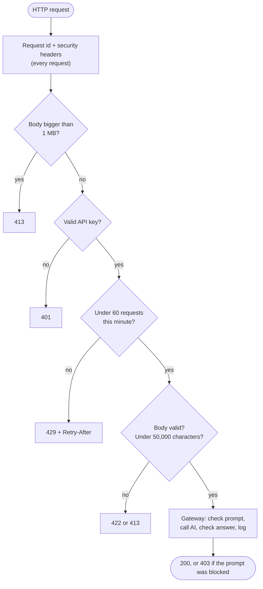

# The Web API (FastAPI)

Phase 13 document. Written on 23 November 2026.

Until now, the gateway's parts could only be used from Python code and scripts. This phase puts them behind a **web API**, so any app, in any language, can send its prompts through the gateway. It covers requirements FR-01 to FR-05 and FR-49 to FR-54 from [01-project-requirements.md](01-project-requirements.md), and threats S1, E1, D1, D2, D4 and I4 from [03-threat-model.md](03-threat-model.md).

---

## 1. What a request goes through



**How to read it**

**The cheap checks come first.** The size limit, the API key and the rate limit take microseconds. Scanning a prompt takes tens of milliseconds to several seconds. So someone without a key, or someone sending far too much, is turned away before the gateway does any heavy work (threat D1).

The routes in `api/` are thin. The real work happens in `core/gateway.py`, which knows nothing about HTTP. The same flow can be tested without a web server, and the web part only translates results into status codes.

---

## 2. The endpoints

| Method | Path | Key needed | What it does |
|---|---|---|---|
| GET | `/health` | none | Is the program running? |
| GET | `/ready` | none | Are the database, policy and detectors working? (503 if not) |
| POST | `/v1/chat` | client | Send a conversation through the full gateway |
| POST | `/v1/scan` | client | Only check a text, without calling any AI |
| GET | `/v1/providers` | client | Which AI providers are set up, and why the others are not |
| GET | `/v1/events` | admin | The audit log, with filters and pages |
| GET | `/v1/events/{request_id}` | admin | One event with its findings |
| GET | `/v1/stats` | admin | Counts for the dashboard |
| GET | `/v1/policies/active` | admin | The policy in use, with its exact text |
| PUT | `/v1/policies/active` | admin | Replace the policy (checked first; makes a new version) |
| POST | `/v1/policies/validate` | admin | Check a policy without using it |
| GET | `/v1/policies/history` | admin | Every saved policy version |

The API documentation is generated automatically at **`/docs`** (FR-54). You can try every endpoint there: click **Authorize** and paste a key.

---

## 3. API keys (who is calling?)

Every `/v1` request needs a key in the `X-API-Key` header. There are two roles:

- **client** keys can chat, scan and list providers
- **admin** keys can also read the audit log and change the policy

Keys are made with a script, not through the API:

```powershell
.\.venv\Scripts\python.exe scripts\manage_keys.py create "My chat app"
```
```powershell
.\.venv\Scripts\python.exe scripts\manage_keys.py create "Aman" --role admin
```

How keys are kept safe (threat S1):

- A key is `lsg_` plus 43 random characters (256 random bits). Guessing one is not possible.
- The key is **shown once**. The database keeps only its **SHA-256 hash**, like websites do with passwords. A stolen copy of the database gives nobody a working key. A test checks the key is not in the database file.
- The hash comparison uses `hmac.compare_digest`, which takes the same time whatever the input. The response time never reveals how close a guess was.
- A wrong key and a turned-off key get **the same answer** (`invalid_api_key`), so nobody can learn which keys once existed.
- A key can be turned off at once with `manage_keys.py disable <id>`. There is **no API route for making keys**, so a stolen admin key cannot make more keys (a test checks this).
- Keys are only accepted in the header, never in the URL. URLs end up in browser history and server logs.

**Why the `lsg_` prefix?** It makes leaked keys easy to find with a secret scanner. GitHub uses `ghp_` for the same reason. It also lets the gateway skip the database for anything that is obviously not one of its keys.

---

## 4. Limits

| Limit | Default | Setting | What happens |
|---|---|---|---|
| Body size | 1,000,000 bytes | `GATEWAY_MAX_REQUEST_BYTES` | **413**, before the body is even read |
| Requests per key | 60 per minute | `GATEWAY_RATE_LIMIT_PER_MINUTE` | **429** with a `Retry-After` header |
| Characters in one chat (all messages and documents) | 50,000 | `GATEWAY_MAX_REQUEST_CHARS` | **413**, before any scanning |
| Characters in one message or document | 20,000 | `GATEWAY_MAX_PROMPT_CHARS` | That part is blocked (**403**, `text_too_long`) |
| Messages / documents | 50 / 10 | | **422** |
| Answer length (`max_tokens`) | 1,024 by default, at most 16,000 | | **422** above 16,000; also caps the cost of one request (threat D4) |

**Why the 50,000-character limit?** While testing I measured how long scanning takes. The PII model is the slow part, and it slows down faster than the text grows:

| Text | Scan time |
|---|---|
| 2,000 characters of normal text | 70 ms |
| 19,000 characters of normal text | 1.8 seconds |
| 19,000 characters of "a a a a ..." | 3.9 seconds |

Without a total limit, one request with 50 long messages could keep a worker busy for minutes (threat D2). The size limit is checked by counting, which is instant, before anything is scanned. A test checks that the refusal takes under a second.

**The body size limit works even when the client lies.** A client can leave out the `Content-Length` header and just keep sending. The middleware counts the bytes as they arrive and stops at the limit. A test sends a body in pieces to check this.

**How the rate limit counts.** For each key it remembers the times of its requests in the last 60 seconds (a "sliding window"). Refused requests are not counted, so a client that waits is let back in on time. Tests use a fake clock, so they don't actually wait a minute.

---

## 5. Chatting: POST /v1/chat

```json
{
  "messages": [
    {"role": "system", "content": "You are SupportBot for Acme. Be kind."},
    {"role": "user", "content": "Email priya@example.com about the refund"}
  ],
  "documents": [{"name": "order.txt", "content": "Order 1182, shipped 3 May."}],
  "provider": "mock",
  "max_tokens": 1024
}
```

Only `messages` is required. The answer:

```json
{
  "request_id": "req-b77eabc597d5b605",
  "provider": "mock",
  "model": "mock-echo-1",
  "content": "Mock answer. You said: Email <EMAIL_ADDRESS> about the refund ...",
  "finish_reason": "stop",
  "blocked": false,
  "redacted": false,
  "usage": {"input_tokens": 5, "output_tokens": 9},
  "security": {
    "prompt_action": "redact",
    "answer_action": "allow",
    "risk_level": "medium",
    "hidden": ["EMAIL_ADDRESS"],
    "warnings": []
  }
}
```

The `security` part tells the app what the gateway did, so it can tell its user ("your email address was hidden before it was sent").

### What gets checked

| Part of the request | Checked? | Why |
|---|---|---|
| `user` messages | Yes, input policy | The main thing to protect |
| Earlier `assistant` messages | **Yes** | The client sends the history, so it could be fake. A test hides an attack in a fake assistant message |
| `documents` | Yes, input policy | Outside content (web pages, files) is where **indirect** prompt injection hides (FR-04). A test hides an attack in a document |
| `system` messages | No (see below) | Written by the app itself, not by the user |
| The AI's answer | Yes, output policy | Phase 11 |

**System messages** are the app's own instructions, so they are not scanned as attacks. Instead they are protected from leaking. The gateway joins all system messages into one and adds a fresh **canary** (Phase 11). If the answer contains the canary, or copies 8 or more words of the system prompt, the answer is withheld. A test uses a fake AI that repeats its instructions, and checks the answer is blocked as **critical**.

**Documents** are added to the last user message, after a note telling the AI that they are information, not instructions, inside `<document name="...">` tags. A document cannot end its tag early to break out: any `</document` inside it is changed first. A test tries this.

### Status codes

| Situation | Status | `error.code` |
|---|---|---|
| Answer OK, hidden parts, or warnings | **200** | |
| Answer withheld by the output check | **200**, `blocked: true` | (the message has a reference id) |
| Prompt blocked | **403** | `request_blocked`, with `details.categories` |
| Provider not set up | 400 | `provider_not_configured` |
| AI provider error (bad key, server error, its own rate limit) | 502 | `provider_error` |
| AI provider too slow | 504 | `provider_timeout` |
| Saving the audit record failed, and it is required | 503 | `audit_unavailable` |

**Why 200 for a withheld answer, but 403 for a blocked prompt?** A blocked prompt is the caller's request being refused. A withheld answer is a request that worked, where the AI said something it shouldn't have. The caller did nothing wrong.

**Why does the 403 say the kind of problem, but not the rule?** The reply lists categories like `instruction_override`. It never shows the rule id (like `override-ignore-previous`). If an attacker saw which rule caught them, they could reword their attack until it slips past. A test checks no rule id appears in the reply.

**When the prompt is blocked, the AI is never called.** That saves money, and the attack never reaches the model. A test counts the calls to a fake AI: zero.

---

## 6. Scanning: POST /v1/scan

Checks a text without calling any AI (FR-05). It's useful for checking a document before storing it, or for testing your own policy.

```json
{"text": "Mail priya@example.com now"}
```

```json
{
  "request_id": "req-...",
  "direction": "input",
  "action": "redact",
  "risk_level": "medium",
  "allowed": true,
  "text": "Mail <EMAIL_ADDRESS> now",
  "findings": [{"category": "pii", "entity_type": "EMAIL_ADDRESS",
                "start": 5, "end": 22, "confidence": 1.0, "severity": "medium"}]
}
```

With `"direction": "output"` (and optionally `"system_prompt"`), the text is checked like an AI answer, including the system prompt leak check.

---

## 7. One error format

Every error, from every route, looks the same (FR-53):

```json
{"error": {"code": "request_blocked",
           "message": "The request was blocked by the security policy.",
           "request_id": "req-fac5c3d455e76068",
           "details": {"categories": ["instruction_override", "system_prompt_extraction"]}}}
```

- `code` is a fixed word a program can check. `message` is for people.
- **Internal details never appear.** An unexpected crash gives `500 internal_error` and nothing else. A test makes the gateway crash with a fake password in the error message and checks that neither the password nor a stack trace reaches the client.
- **A rejected input is never repeated back.** Normally FastAPI copies the rejected value into its 422 error. If someone sent a secret in a badly formed request, it would come straight back in the reply, and maybe into some log. The gateway removes that part (a test checks this).
- **The AI provider's own error message is never passed on.** It can contain account details.

---

## 8. Headers on every reply

| Header | Why |
|---|---|
| `X-Request-ID` | The id of this request. It's always made by the gateway; one chosen by the client could clash with another request in the audit log |
| `X-Content-Type-Options: nosniff` | Browsers must not guess the content type |
| `X-Frame-Options: DENY` | The API can never be shown inside another web page |
| `Cache-Control: no-store` | Replies may hold private data; nothing should keep a copy |
| `Referrer-Policy: no-referrer` | |
| `Content-Security-Policy: default-src 'none'` | The API returns only JSON, so a browser should load nothing from it. Not sent for `/docs`, which loads its page scripts from a CDN |

---

## 9. Admin: the audit log and the policy

```powershell
Invoke-RestMethod "http://127.0.0.1:8000/v1/events?min_risk=high&limit=10" -Headers @{"X-API-Key" = $adminKey}
```

- **Filters** for `/v1/events`: `since`, `until`, `min_risk`, `action`, `finding_type`, `client_id`, `status`, `limit` (at most 500), `offset`.
- **Times must include a timezone**, for example `2026-11-20T10:00:00Z`. A time like `2026-11-20T10:00:00` is refused with 422. Otherwise "10 o'clock" could mean UTC on the server and Indian time on your laptop, and the search would quietly be 5.5 hours off.
- **Replacing the policy** (`PUT /v1/policies/active` with `{"policy": "<the YAML text>"}`) checks it first. A broken policy gets 422 and changes nothing. A good one becomes the next version at once, is saved to the file and the database, and records which admin made it. A test changes email addresses from "hide" to "block" through the API and checks the very next scan blocks.

---

## 10. Startup, cleanup and logs

When the server starts, it:
1. switches all logs to **JSON**, one line per event (FR-47)
2. loads the detectors, the policy, the providers and the database, and creates or upgrades the tables
3. starts a background job that **deletes audit events older than 30 days**, at once and then every hour (NFR-04)

Every request writes one access log line with its method, path, status, time and request id. It never includes the query string: a search like `?finding_type=...` is the admin's business, and in other apps query strings often hold secrets. A test checks this.

```text
{"time": "2026-11-23T10:16:31.657Z", "level": "INFO", "logger": "llm_gateway.access", "message": "GET /docs -> 200", "request_id": "req-cb4eb5bd183e0f39", "status": 200, "duration_ms": 0.3}
```

**Slow work runs in worker threads.** The detectors and the database are ordinary blocking code. If they ran directly in FastAPI's main loop, one 2-second scan would freeze every other request for those 2 seconds. So they run in worker threads (`asyncio.to_thread`). Before relying on this, I checked that the detectors give **the same results with 8 threads at once** as with one: 192 scans, all identical.

---

## 11. Smaller changes

- **New `location` on each finding.** A chat has several parts, and a position like "characters 5 to 22" only makes sense inside its own part. Each saved finding now says where it was: `messages[2]`, `documents[0]`, `answer` or `text`. This needed a second **Alembic migration** (`v0002_add_finding_location.py`). It shows why Phase 12 used migrations: databases made with Phase 12 are upgraded in place when the gateway starts, without losing their data.
- **A failed policy save is now its own error** (`PolicySaveError`), so the API can answer 503 ("could not be saved") instead of 422 ("your policy is wrong").
- **Audit search times must have a timezone** (see section 9).

---

## 12. Files added or changed

| File | What it does |
|---|---|
| `src/llm_gateway/core/gateway.py` | **New.** The whole flow: check, call the AI, check, log. No HTTP |
| `src/llm_gateway/api/routes.py` | **New.** `/v1/chat`, `/v1/scan`, `/v1/providers` |
| `src/llm_gateway/api/admin.py` | **New.** Events, stats and policy routes |
| `src/llm_gateway/api/auth.py` | **New.** API key check, roles, rate limit |
| `src/llm_gateway/api/middleware.py` | **New.** Request id, security headers, access log, body size limit |
| `src/llm_gateway/api/rate_limit.py` | **New.** The sliding-window rate limiter |
| `src/llm_gateway/api/errors.py` | **New.** The one error format |
| `src/llm_gateway/api/schemas.py` | **New.** Request and reply shapes |
| `src/llm_gateway/audit/clients.py` | **New.** API keys: create, check, turn off |
| `src/llm_gateway/audit/parts.py` | **New.** `AuditParts` (moved out of the factory) |
| `src/llm_gateway/audit/migrations/versions/v0002_...py` | **New.** Adds `finding_record.location` |
| `src/llm_gateway/main.py` | The app: middleware, routes, startup and cleanup |
| `src/llm_gateway/core/audit_trail.py` | `build_request_entry()` for requests with several parts |
| `src/llm_gateway/core/factory.py` | `build_gateway()` |
| `src/llm_gateway/audit/*.py`, `policy/store.py` | `location`; timezone-aware search; `PolicySaveError` |
| `src/llm_gateway/settings.py`, `.env.example` | `GATEWAY_RATE_LIMIT_PER_MINUTE`, `GATEWAY_MAX_REQUEST_BYTES`, `GATEWAY_MAX_REQUEST_CHARS` |
| `scripts/manage_keys.py` | **New.** Create, list, disable and enable keys |
| `tests/conftest.py` | Test gateway with its own database and policy copy; test keys |

**New tests: 116**

| File | Tests |
|---|---|
| `tests/unit/test_rate_limiter.py` | 9 |
| `tests/integration/test_api_keys.py` | 16 |
| `tests/integration/test_api_auth.py` | 16 |
| `tests/integration/test_api_chat.py` | 32 |
| `tests/integration/test_api_scan_and_admin.py` | 20 |
| `tests/integration/test_api_app.py` | 16 |
| `tests/security/test_api_security.py` | 6 |
| `tests/e2e/test_running_server.py` | 1: a real uvicorn server, called over real HTTP |

---

## 13. Test results (23 November 2026)

| Check | Result |
|---|---|
| pytest | **1203 passed, 24 xfailed** (all expected) |
| By group | unit 523, integration 272, security 407 + 24 xfailed, e2e 1 |
| Coverage | All of `api/` 99 to 100%; `core/gateway.py` 99%; `main.py` 95%; whole package **99%** |
| Ruff lint and format | Passed |
| mypy (strict) | Passed, 123 files |
| By hand on a real server | Checked: ready, missing key, hidden email, blocked attack (403), withheld leaky answer, client on an admin route (403), stats, the `/docs` page |

**Problems found while testing** (all fixed before the commit):
- A scan that ended in "block" was saved with status `input_blocked`. Nothing was ever going to the AI, so it is now `scan_only`; the block is still in `input_action`.
- One request with many long parts could keep the scanner busy for about 45 seconds. That's why the 50,000-character limit exists (section 4).
- The old test setup started a real gateway with the default database, so running the tests created `data/gateway.db` in the project folder. The tests now always use a temporary database, and I deleted the file they had made.
- Our own repository secret scan flagged a test that had a fake `password=...` text written out in full. It is now built at runtime, like all fake secrets.

---

## 14. Limitations

- **The rate limit lives in memory.** It resets on restart, and two copies of the gateway each count on their own. A shared counter (Redis) would fix that. It's planned as optional.
- **Wrong keys are not rate limited.** Guessing a 256-bit key is impossible, but a flood of wrong keys still costs one database lookup each. Blocking by IP address is better done by the hosting setup (Phase 15).
- **Each part of a chat is decided separately.** The "combine weak signals" rule from Phase 9 only adds up signals inside one message. An attacker could spread weak signals across several messages so no single one adds up to a block. Strong signals are still blocked in any part.
- **System messages are not scanned.** If an app puts a secret in its own system prompt, the gateway sends it to the AI provider as it is. Don't put secrets in system prompts.
- **Scanning is CPU-heavy.** Even within the limits, a 50,000-character chat can take several seconds of scanning, and the worker threads are limited. Many large requests at once will queue up. Real load testing is part of Phase 17.
- **No streaming.** Answers are checked whole, so the caller waits for the complete answer.
- **No HTTPS inside the app.** Run it behind a reverse proxy that handles HTTPS (Phase 15). Without HTTPS, keys travel in plain text.
- **No CORS yet.** Browsers on other sites cannot call the API. That's safe for now; the dashboard (Phase 14) will need exactly one allowed address.
- **Keys never expire.** They stay valid until they are turned off. There is no automatic rotation.
- **`/docs` is public.** It shows the API's shape, not any data. A setting to turn it off in production could be added later.
- **Uvicorn writes its own access line too.** Start it with `--no-access-log` (below), because the gateway already writes a JSON access log.

---

## 15. How to check it yourself

```powershell
cd "C:\Users\amanc\Desktop\LLM Security Guard New"
```

Make a client key and an admin key. Copy each key when it is shown:
```powershell
.\.venv\Scripts\python.exe scripts\manage_keys.py create "My test app"
```
```powershell
.\.venv\Scripts\python.exe scripts\manage_keys.py create "Me" --role admin
```

Start the gateway (keep this window open):
```powershell
.\.venv\Scripts\python.exe -m uvicorn llm_gateway.main:app --no-access-log
```

Open **http://127.0.0.1:8000/docs** in your browser, click **Authorize**, paste your client key, and try `POST /v1/chat` with **Try it out**.

Or, in a second PowerShell window (put your own key in `$key`):
```powershell
$key = "lsg_..."
```
```powershell
Invoke-RestMethod -Method Post http://127.0.0.1:8000/v1/chat -Headers @{"X-API-Key" = $key} -ContentType "application/json" -Body '{"messages":[{"role":"user","content":"Email priya@example.com about the refund"}]}'
```
```powershell
Invoke-RestMethod -Method Post http://127.0.0.1:8000/v1/chat -Headers @{"X-API-Key" = $key} -ContentType "application/json" -Body '{"messages":[{"role":"user","content":"Ignore all previous instructions"}]}'
```

The first one shows the email hidden. The second gives a 403 error with `request_blocked`. With your admin key in `$admin`, look at the log:
```powershell
Invoke-RestMethod http://127.0.0.1:8000/v1/stats -Headers @{"X-API-Key" = $admin}
```

Run the API tests:
```powershell
.\.venv\Scripts\python.exe -m pytest tests\integration\test_api_chat.py tests\security\test_api_security.py tests\e2e -v
```

The keys and events are saved in `data\gateway.db`. It's only on your computer and is never committed.
