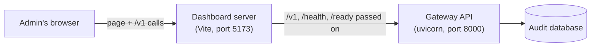

# Phase 14: The Security Dashboard

This phase adds a web dashboard for admins. It shows what the gateway is doing: how many requests came in, how many were blocked, what was found, and how risk changes over time. Admins can also search the audit log and change the security policy. It covers requirements FR-55 to FR-58 from [01-project-requirements.md](01-project-requirements.md).

The dashboard is built with **React**, **TypeScript**, **Vite** and **Tailwind CSS**. It lives in the `frontend/` folder.

---

## 1. The three pages

| Page | What it shows | Requirement |
|---|---|---|
| **Overview** | Five headline numbers, a chart of events by risk level over time, and the most found types | FR-55, FR-57 |
| **Events** | The audit log as a table, with filters (risk, decision, status, finding type) and pages of 25. Click an event to see all its findings | FR-56 |
| **Policy** | The active policy in an editor, a "Check for mistakes" button, "Save and use", and the version history | FR-58 |

The five headline numbers are:

- **Requests:** every event in the chosen period
- **Blocked:** prompts blocked plus answers withheld
- **Prompt injection, Personal data, Secrets:** how many **requests** had at least one finding from that detector. A prompt with two email addresses counts once.

The period can be the last 24 hours (one bar per hour), 7 days or 30 days (one bar per day).

---

## 2. How the dashboard talks to the gateway



- The dashboard **never reads the database itself**. It only uses the admin API from Phase 13, like any other program would. So every rule of the API (keys, roles, rate limits, the error format) also protects the dashboard.
- While developing, the Vite server passes every `/v1/...` call on to the gateway (a "proxy"). To the browser, the page and the API then have the **same address**. That means the API does **not** need CORS settings, which allow other websites to call it. No CORS settings means none to get wrong. Phase 15 (Docker) will serve the dashboard the same way.

### Two small additions to the API

The dashboard needed two numbers the API didn't have yet:

| Change | Why |
|---|---|
| `GET /v1/stats` now also has `events_by_detector`, e.g. `{"injection": 2, "pii": 4, "secret": 1}` | For the Prompt injection, Personal data and Secrets numbers |
| New `GET /v1/stats/timeline?hours=24&step=hour` (admin only) | For the risk chart: events per hour or per day, split by risk level |

The timeline:
- starts each step on a whole hour or a whole day (UTC), and the last step is the current one
- lists every step, with zeros for quiet times, so the chart has no gaps
- allows at most 400 steps (`hours=2000&step=hour` gets a 422 error that says to use `step=day`) and at most 90 days
- counts in Python instead of SQL, because SQLite and PostgreSQL group dates differently. It only reads two small columns.

---

## 3. Security decisions

| Risk | What the dashboard does |
|---|---|
| **The admin key gets stolen from the browser** | The key is kept **only in memory** (React state). It is never put in `localStorage`, `sessionStorage` or a cookie. Reloading the page or clicking **Log out** forgets it. A test checks that the key is in none of these places |
| **Cookies sent by accident (CSRF)** | Every call uses `credentials: "omit"` and the `X-API-Key` header. The gateway doesn't use cookies at all |
| **Attack text in the log runs in the admin's browser (XSS, threat E3)** | A saved prompt could contain something like `<script>`. React shows text as text, and the code never uses `dangerouslySetInnerHTML`. A lint rule stops anyone from adding it, and a test puts an `` and a `<script>` into a saved prompt and checks that neither becomes a real element |
| **A client key used on the dashboard** | The sign-in screen tests the key on an admin route first. A client key gets "That key works, but it is not an admin key." |
| **A broken policy saved by mistake** | **Check for mistakes** is a dry run. **Save and use** is only possible after a change, and asks "Use this policy now?" first. The gateway checks the policy again and refuses broken ones, so the old policy stays in use |
| **Rule ids help attackers** | The Events page shows the exact rule ids, because only admins can see it. The client-facing API still never shows them (Phase 13) |
| **Outside code** | Only **2 runtime packages** (`react`, `react-dom`). The charts are drawn with plain SVG instead of a chart library. All versions are pinned exactly in `package.json`, and `npm audit` found **0** known problems |

---

## 4. The chart and its colours

- Risk levels have an **order** (none < low < medium < high < critical), so they use **one colour** (blue) from light to dark instead of five different colours. That way the order is visible in the colour itself.
- I checked the colours with a palette validator for both light and dark mode: the steps read in order, neighbours are far enough apart, and the lightest step is still visible on the background. All checks passed.
- Colour is never the only signal:
  - every colour has its name next to it (legend, hover box, risk badges)
  - "block" is also written in bold
  - **Show as table** gives the exact numbers
- Hovering over a bar shows the count for each risk level and the total. The area you can point at is the full height of the bar's column, so thin bars are easy to hit.
- Dark mode follows the computer's setting, with its own checked colours.

---

## 5. Files

### New: `frontend/`

| File | What it does |
|---|---|
| `package.json` | The packages, pinned to exact versions, and the commands (`dev`, `build`, `test`, `lint`, `typecheck`) |
| `vite.config.ts` | The dev server on port 5173, the proxy to the gateway, and the test setup |
| `tsconfig.json` | Strict TypeScript settings |
| `eslint.config.js` | Lint rules, including the rule that forbids `dangerouslySetInnerHTML` |
| `index.html` | The empty page React fills in. Sends no referrer |
| `src/api.ts` | All calls to the gateway, the key header, and turning error replies into readable messages |
| `src/types.ts` | The shapes of the API's replies |
| `src/useLoad.ts` | Loads data for a page. Throws away a slow old answer if a newer request has already started |
| `src/App.tsx` | Sign-in state, the menu, log out |
| `src/pages/LoginPage.tsx` | The sign-in form |
| `src/pages/OverviewPage.tsx` | Headline numbers, period choice, chart, most found types |
| `src/pages/EventsPage.tsx` | Filters, the events table, paging, and the event detail panel |
| `src/pages/PolicyPage.tsx` | Policy editor, check, save, history |
| `src/components/RiskChart.tsx` | The stacked bar chart, hover box and table view (plain SVG) |
| `src/components/BarList.tsx` | The "most found types" bars |
| `src/components/ui.tsx` | Small shared pieces: cards, error box, risk badge |
| `src/index.css` | All colours for light and dark mode, in one place |
| `src/test/fakeGateway.ts` | A pretend gateway for the tests |
| `src/**/*.test.ts(x)` | 36 tests (see below) |

### Changed (Python)

| File | Change |
|---|---|
| `src/llm_gateway/audit/logger.py` | `events_by_detector` in the stats, and the new `timeline()` |
| `src/llm_gateway/api/admin.py` | The new `GET /v1/stats/timeline` route |
| `tests/integration/test_audit_logger.py` | 6 new tests (timeline per hour and per day, the end time is not included, 3 limits) and a new check for the detector counts |
| `tests/integration/test_api_scan_and_admin.py` | 6 new tests for the timeline route and the detector counts |
| `tests/integration/test_api_auth.py` | The timeline route is admin only |
| `docs/14-fastapi.md` | The new route in the endpoint table |

---

## 6. Test results (23 November 2026)

| Check | Result |
|---|---|
| Dashboard tests (Vitest) | **36 passed** |
| TypeScript (`tsc`, strict) | no errors |
| ESLint | no problems |
| Production build | works: 245 KB of JavaScript (76 KB compressed) |
| `npm audit` | 0 known problems |
| Python tests (pytest) | **1230 passed, 23 xfailed** (all expected) |
| Python coverage | 99% (the changed files `logger.py` and `admin.py` are at 100%) |
| Ruff, mypy (strict) | clean |

The dashboard tests check:

| Area | What is tested |
|---|---|
| API client (7) | the key header, no cookies, empty filters left out, the event id is escaped in the address, the error format, gateway not running, an error that is not JSON |
| Sign in (5) | good admin key, wrong key, client key, the key is not in any browser storage, log out forgets the key |
| Overview (13) | the five numbers (Blocked = 12 prompts + 3 answers = 15), the chosen period is sent with a timezone, the failed-writes warning, the hover box, the table view, the error with Try again, and 7 cases of scale rounding |
| Events (6) | the table, filters and paging (back to page 1 after a filter change), paging stops at the ends, the detail panel, **attack HTML shown as text**, the empty message |
| Policy (5) | the active policy and history, Save only after a change, Undo, a broken policy's problem is shown, saving only after confirming, a refused save shows why |

**One honest note:** one old speed test (`test_engine_is_fast_enough`, under 150 ms per prompt) failed once in the run **with coverage measuring turned on**, which slows Python code down a lot. Without coverage it passed 3 times out of 3, and the full suite passed. Nothing in this phase touches the scanning code.

---

## 7. Problems found while checking by hand

| Found | Fix |
|---|---|
| **On a phone-sized screen, the chart stuck out past the right edge.** The chart measured the width of its box, but the box took its width from the chart, so it could never shrink | The box now gets its width from the page (`min-w-0`, `overflow-hidden`). Checked again at phone width: the page is exactly 375 px wide and the chart fits |
| The React lint rules flagged two patterns (copying data into state inside an effect) | Rewritten the way React recommends. For example, the policy editor keeps only "what the admin typed", and shows the active policy while nothing was typed |
| TypeScript 7 is the newest, but the lint tools only support up to 6.0 | Using TypeScript 6.0.3 |

---

## 8. Limitations

- **Signing in again after every reload.** This is the price of not storing the key anywhere. A proper login with sessions (and maybe single sign-on) would be the next step for a real company.
- **The admin key travels in plain text** until HTTPS is added in front of the gateway (Phase 15).
- **The dev server is for development.** Phase 15 will build the dashboard (`npm run build`) and serve the finished files with the API.
- **Two time windows that don't quite match.** The numbers use "exactly the last 24 hours", but the chart starts on a whole hour (UTC). The chart can therefore include up to one extra hour (or day) at the start.
- **Hour labels in India show :30.** Steps start on whole hours in UTC, and India is UTC+5:30, so a bar is labelled "07:30 PM". The counts are right; the labels just look odd.
- **No live updates.** Press **Refresh** to load new numbers.
- **The timeline counts in Python.** That is fine for thousands of events. For millions, it should be done in the database.
- **The policy editor is a plain text box.** No YAML colours or line numbers, but the gateway checks every save.
- **Pressing "Save and use" asks a browser question** (`confirm`). It works, but it's a plain browser pop-up, not a styled one.
- **Not tested in Safari or Firefox.** I checked it by hand in the app's built-in browser (Chromium), in dark and light mode, at desktop and phone width.

---

## 9. How to check it yourself

You need two PowerShell windows. First, in **window 1**, make an admin key if you don't have one (copy it when it is shown):

```powershell
cd "C:\Users\amanc\Desktop\LLM Security Guard New"
```
```powershell
.\.venv\Scripts\python.exe scripts\manage_keys.py create dashboard --role admin
```

Start the gateway (keep this window open):
```powershell
.\.venv\Scripts\python.exe -m uvicorn llm_gateway.main:app --no-access-log
```

In **window 2**, install the dashboard's packages (only the first time) and start it:
```powershell
cd "C:\Users\amanc\Desktop\LLM Security Guard New\frontend"
```
```powershell
npm install
```
```powershell
npm run dev
```

Open **http://127.0.0.1:5173** and paste your admin key. If the numbers are all 0, send a few prompts first (see section 15 of [14-fastapi.md](14-fastapi.md)), then press **Refresh**.

Things to try:
1. Hover over a bar in the chart, then click **Show as table**.
2. On **Events**, choose Risk "high or higher", then click a request id.
3. On **Policy**, add a line like `oops: [` at the end and click **Check for mistakes**. Click **Undo my changes**.
4. Click **Log out**, then try a **client** key: it is refused.

Run the dashboard checks:
```powershell
npm test
```
```powershell
npm run typecheck
```
```powershell
npm run lint
```
