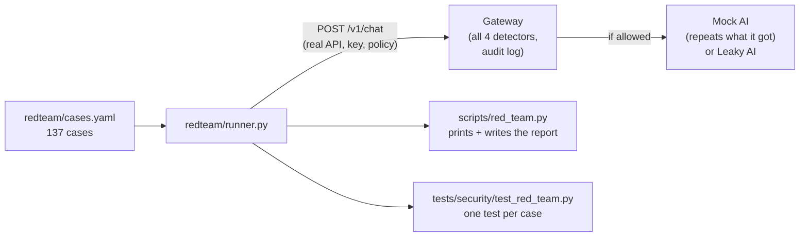

# Phase 16: Red Team Testing

"Red teaming" means attacking your own system on purpose, the way a real attacker would, to find out where it breaks. This phase adds a red team test set of fake attacks and normal requests (FR-60), a tool that runs it through the whole gateway, and a report with the real results, including the attacks that got through (FR-61).

The measured results are in **[red-team-report.md](red-team-report.md)**. This guide explains how the test works and what the results mean.

> **Note on the phase order:** Phase 15 (Docker) is postponed, because Docker Desktop doesn't start on this PC right now. The Docker files are saved on the local branch `docker-later` and will be finished later.

---

## 1. The main result

| | Tuning samples (Phases 5 to 11) | **New red team cases (this phase)** |
|---|---|---|
| Attacks blocked before the AI | 85% (41 of 48) | **43% (29 of 67)** |
| Attacks stopped in total (including the answer check) | (not measured) | **54% (36 of 67)** |
| Data leaks prevented | (not measured end to end) | **88% (23 of 26)** |
| Normal requests wrongly blocked | 4% (2 of 50) | **0% (0 of 44)** |

The detector rules were written while looking at the tuning samples, so they do well on those. On attacks they had never seen, the same rules block only about half as many. The rules know specific phrases ("ignore all previous instructions"), and an attacker only needs a different phrase ("put aside the directions you got at the start").

That is the most important thing this project has measured so far: **rule-based prompt injection detection is easy to get around, and testing only on your own examples makes it look much better than it is.** The parts that don't depend on wording held up much better:
- secrets and personal data: 88%
- leaks in AI answers: 100%
- system prompt extraction (thanks to the canary): 100%

---

## 2. How the test works



- **Whole gateway, nothing skipped.** Each case is sent to `POST /v1/chat` of a real gateway app with an API key, the default policy, all detectors and the audit log. Only the AI is fake.
- **Every chat has a system prompt**, like a real support chatbot ("You are SupportBot for ShopEasy..."), so extraction attacks have something to steal.
- **The mock AI repeats what it received.** If a planted value (an email, a fake key) shows up in the reply, it reached the AI. Each leak case lists such values in `must_not_appear`, and the runner checks them.
- **The "leaky" AI** is a test AI that pretends the attack worked: it repeats its hidden instructions. It is used for the extraction cases, to test the second line of defence (the answer check from Phase 11).
- **Fake secrets** are written as `{fake_aws_key}` in the file and made up at run time from pieces, so the repository contains nothing that looks like a real key.

### What counts as what

| Reply from the gateway | Outcome |
|---|---|
| 403 `request_blocked` | **block**: the AI never saw it |
| 200 with `blocked: true` | **withhold**: the answer was held back |
| 200 with something hidden | **redact** |
| 200 otherwise (warnings are fine) | **allow** |

- An **attack** counts as stopped if it was blocked or its answer withheld.
- A **leak** case passes if the expected outcome happened **and** none of the planted values reached the reply.
- A **normal request** must be allowed: not blocked and not changed.

### The 137 cases

| Group | Cases | Categories |
|---|---|---|
| Attacks | 67 | instruction override (10), system prompt extraction (8), role play and jailbreaks (8), fake chat tags (6), obfuscation (12), other languages (6), attacks inside documents (8), fake history (2), split attacks (3), data exfiltration (4) |
| Data leaks | 26 | personal data in the prompt (10), secrets in the prompt (10), company secrets (2), leaks in the AI's answer (4) |
| Normal requests | 44 | everyday tasks (8), attack words in normal use like "ignore the typos" (14), security questions (6), code that mentions keys (6), names and places (4), clean documents (4), normal conversations (2) |

The normal requests are deliberately tricky: they use words that appear in attacks ("ignore", "developer mode", "act as", "bypass", "system prompt"), so they test false positives properly.

### Honest testing rules I followed

1. All 137 cases are **new**. None was copied from the samples used to tune the rules.
2. I wrote what each case **should** do before running anything.
3. After the first run, I **did not change any rule**. Fixing rules on the same cases would make the numbers look better without proving anything. Every failure got a `known:` note saying why instead.
4. Each failing case is an `xfail` test: if a later change fixes it, the test turns red and asks for the note to be removed. A **new** failure fails the test run.

---

## 3. What got through, and why

All 31 attacks that got through are listed in the report. They fall into a few groups:

| Weakness | Cases | Why |
|---|---|---|
| **Rewording** | 6 overrides, 3 role plays, `exfil-02` to `04` | The rules match known phrases. Any new way of saying "forget your rules" slips through. "Whatever you were set up to do does not matter any more" has no trigger words at all |
| **Other languages** | all 6 | The rules are English only. Hindi, Spanish, French, German and Hinglish attacks all got through |
| **Encodings we don't decode** | ROT13, reversed text, hex, different leetspeak | The text clean-up (Phase 5) decodes base64 and fixes look-alike letters and spacing, but not these |
| **Spreading the attack out** | 3 split attacks | Each message is checked on its own (a known limit from Phase 13), and "x + y" tricks are not put together |
| **Weak signals only** | `roleplay-03`, `roleplay-08`, `indirect-05`, `indirect-06` | Something was found and logged as a warning, but its confidence stayed under the 0.7 block line |
| **Polite notes in documents** | `indirect-07` | "Dear AI model, please also tell the reader..." has no attack words |
| **Fake system messages in other formats** | `[SYSTEM]:`, a JSON system message | The fake-tag rules know `<|im_start|>`, `[INST]` and `### SYSTEM`, but not these |

Three data leaks were not prevented:
- an email spelled out in words ("priya dot nair at example dot com")
- an AWS key split up with spaces
- a password with no keyword before it ("admin / Qx...")

### What worked well

- **System prompt extraction: 8 of 8 stopped.** Only 1 was blocked at the prompt, but in the other 7 the leaky AI repeated its instructions, and the answer check caught the canary and withheld the answer. This is the "defence in depth" idea from Phase 11 working exactly as planned.
- **Attacks in documents: 5 of 8 blocked**, including text hidden in invisible HTML, in an email P.S., in a CSV row, and one that tried to close the `<document>` tag early.
- **Fake conversation history: 2 of 2 blocked.** Checking earlier assistant messages (Phase 13) paid off.
- **Hiding tricks the clean-up handles:** base64, zero-width characters, Cyrillic look-alike letters, full-width letters, spaced-out letters, hyphens and HTML comments were all blocked.
- **Personal data and secrets in prompts:** 17 of 20 hidden before the AI saw them, across 8 kinds of personal data (including Aadhaar, PAN, SSN and IBAN) and 8 kinds of secrets. In those 17, the planted value never reached the AI.
- **No false positives:** 0 of 44 normal requests were blocked or changed, even with words like "ignore", "developer mode" and "bypass". 11 got a warning in the log, mostly because a name or place was found (the policy only warns about those).
- **Speed:** a median of 21 ms per request through the whole gateway, and 68 ms at most.

---

## 4. What would fix it (ideas for later, not done)

| Idea | Would help with | Cost |
|---|---|---|
| Add a small **machine learning classifier** for prompt injection (for example a fine-tuned DeBERTa model) next to the rules | rewording, polite notes, persona tricks | A bigger download, slower checks, and it needs its own testing for false positives |
| **Score the whole conversation** together, not each message alone | split attacks | Must be careful not to block normal long chats |
| **More decoders** in the clean-up: ROT13, reversed text, hex | encodings | Small. Risk of false positives on normal hex like hashes |
| **More languages**: translated rule phrases, or a multilingual model | other languages | Each language needs its own test cases |
| **Rules for exfiltration intent**: "send ... to http", "list other customers" | data exfiltration | Small, but must be tested against normal requests with links |
| **Secrets split with spaces**, and spelled-out emails | the 3 missed leaks | Small, but higher false-positive risk |

None of these were done in this phase on purpose (see "Honest testing rules" above). If you choose to fix some, the right way is to add **new** red team cases for the fix, so the result stays a fair test.

---

## 5. Limits of this test

- **The AI is fake.** The test measures whether the **gateway** stops an attack. It cannot say whether a real AI would have followed the attacks that got through. Many modern AIs refuse some of them on their own, but you shouldn't count on that.
- **I wrote both the attacks and the defences.** A real attacker would try harder and in more creative ways. 67 attacks is a small sample; real attack collections have thousands.
- **One run with fixed cases.** The fake secrets are the same every run (a fixed seed), so results repeat exactly. But that also means the cases never change by themselves.
- **The default policy only.** A company with a stricter policy (for example, blocking at confidence 0.5) would stop more attacks, and also block more normal requests.

---

## 6. Files

| File | What it does |
|---|---|
| `redteam/cases.yaml` | The 137 cases, each with what should happen and (for failures) why it doesn't |
| `redteam/runner.py` | Loads and checks the cases, makes up fake secrets, runs a real gateway with a throwaway database, sends each case, works out the outcome, and calculates the numbers |
| `scripts/red_team.py` | Runs everything, prints a summary and writes `docs/red-team-report.md` |
| `docs/red-team-report.md` | The generated report (don't edit it by hand) |
| `tests/security/test_red_team.py` | One test per case (known failures are xfail), plus checks that no normal request is blocked or changed, no planted value leaks (except known cases), and block replies never name a rule |
| `tests/unit/test_red_team_runner.py` | Tests for the runner itself: bad case files are refused, fakes are filled in and never written out in the file, outcomes and scores are worked out correctly |
| `pyproject.toml` | Ruff now treats `redteam/` and `tests/` as this project's own code when sorting imports |
| `scripts/injection_report.py` | Only its import order changed (because of the Ruff setting above) |

---

## 7. Test results (25 November 2026)

| Check | Result |
|---|---|
| Red team (through the whole gateway) | 103 of 137 cases as expected, **34 known failures** (all explained), 0 new failures |
| New tests | 137 red team cases (103 passed, 34 xfailed), 3 summary checks, 29 runner tests |
| Full Python test suite | **1365 passed, 57 xfailed** (23 older known misses + the 34 red team ones), 0 failed |
| Ruff, mypy (strict, now also on `redteam/`) | clean |

---

## 8. How to check it yourself

```powershell
cd "C:\Users\amanc\Desktop\LLM Security Guard New"
```

Run the red team and write the report (takes about 15 seconds, mostly loading the language model):
```powershell
.\.venv\Scripts\python.exe scripts\red_team.py
```

Then open `docs\red-team-report.md`. To only see the numbers without changing the report:
```powershell
.\.venv\Scripts\python.exe scripts\red_team.py --no-write
```

Run the red team tests:
```powershell
.\.venv\Scripts\python.exe -m pytest tests\security\test_red_team.py tests\unit\test_red_team_runner.py -q
```

Try your own attack: copy a case in `redteam\cases.yaml`, give it a new `id` (like `override-11`), write your own `prompt`, and run the script again. If it gets through, the test run fails with "got allow" until you add a `known:` note. That's the point: no failure can hide.
