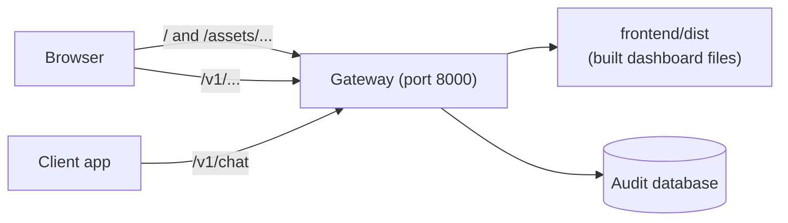

# Phase 17: Final Integration

The earlier phases each built and tested one part. This phase puts them together and tests the **whole system at once**:

- the gateway now serves the dashboard too, so everything runs at **one address** with **one start command**
- a whole-system test follows one story from a client app to the admin and back
- every requirement from [01-project-requirements.md](01-project-requirements.md) was checked against the code and the tests (section 5)

---

## 1. One address, one command

Before this phase, you needed two programs: the gateway (port 8000) and the dashboard's development server (port 5173). Now the gateway serves the **built** dashboard itself:



- `GATEWAY_DASHBOARD_DIR` (default `frontend/dist`) says where the built files are. If there is no `index.html` there, the gateway just runs the API and logs how to build the dashboard. An empty value turns the dashboard off.
- The dashboard is added **after** all API routes, so `/v1/...`, `/health` and `/ready` always win. Unknown paths still get the normal JSON error.
- Node.js is only needed to **build** the dashboard, not to run it.
- **Same address = no CORS.** The browser sees the dashboard and the API at the same address, so the API never has to allow other websites.

### Security headers per kind of reply

| Path | Content-Security-Policy |
|---|---|
| `/v1/...`, `/health`, `/ready` | `default-src 'none'`: the API returns JSON and may load nothing |
| Dashboard pages and files | Scripts, styles and data **only from this same address**. No inline scripts, no outside scripts, can't be shown inside another site |
| `/docs`, `/redoc` | None, because the API docs load their scripts from a CDN |

I checked in a real browser that the dashboard works under this policy: no console errors, and colours, chart bars and bar widths all show.

### The start command: `scripts/serve.py`

```powershell
.\.venv\Scripts\python.exe scripts\serve.py --build
```

Before starting, it checks the things that are easy to forget:

| Check | What happens |
|---|---|
| Production mode without `GATEWAY_FINGERPRINT_KEY` | Refuses to start, and shows how to make a key. `--development` skips this for trying things out |
| Dashboard not built | Says so and starts the API only. `--build` runs `npm ci` and `npm run build` first |
| No admin key yet | Shows the `manage_keys.py` command to make one |

Then it starts uvicorn with:
- **production mode**, even if `.env` says `development` (use `--development` to try things out without a fingerprint key)
- **one worker**: the rate limiter counts in memory, and each worker would load its own 1 GB language model
- **no access log from uvicorn**: the gateway writes its own, without query strings
- **no `Server` header**

### A small fix found by the requirements check

**NFR-02** says that if an admin turns off "fail closed", the change must be logged. It wasn't. With `GATEWAY_FAIL_MODE=open`, the gateway quietly let prompts through when a detector crashed. Now it logs a **warning at startup** that says what this means and how to turn it back. A test checks the warning appears for "open" and not for "closed".

---

## 2. The whole-system test

`tests/e2e/test_whole_system.py` follows one story, with the real detectors, the real policy and a real database. It runs with prompt saving **on**, the hardest case for privacy.

1. **A client app uses the gateway:**
   - a normal question goes through
   - an email and a phone number are hidden (the mock AI repeats what it got, and neither value is in its reply)
   - an AWS key is hidden
   - an attack gets 403
   - a leaky answer is withheld
2. **The admin sees all of it:**
   - the stats count 5 requests, 2 blocks, 1 injection and 2 secrets (one in a prompt, one in an answer)
   - the timeline adds up to 5
   - the high-risk filter finds the attack
   - the event detail shows fingerprints and a saved prompt with `<EMAIL_ADDRESS>` instead of the email
3. **Same person, same fingerprint:** the same email in a second request gets the same fingerprint, so an admin can see it was the same person without ever seeing the email.
4. **The admin makes the policy stricter** (personal data: hide becomes block):
   - it is checked first, then saved as version 2
   - the **very next** chat with an email gets 403
   - the policy file on disk changed
   - the history shows who made the change
   - a client key can't do any of these admin steps
5. **The database file is searched byte by byte** for the email, the phone number and the AWS key. **None of them is in it.** To be sure the test reads the right file, it first checks that the request id and `<EMAIL_ADDRESS>` *are* in it.

More whole-system tests:
- a flood of 5 requests with a limit of 3 per minute gets `200, 200, 200, 429, 429`
- the dashboard is served at `/` with the strict policy, and its script file loads
- the API still wins over the dashboard (for example `/v1/stats` without a key gets 401, not a page)
- unknown paths get the normal JSON 404
- files outside the dashboard folder can't be read (`/../private.txt`, `%2e%2e`, `..%2f`)
- with no build, `/` is a 404 and the API still works
- the **real** built dashboard loads, with every script and style it points to (skipped if it isn't built)
- 5 tests for the start command's checks

---

## 3. Checked by hand (25 November 2026)

With a throwaway database and policy copy, in production mode:

| Step | Result |
|---|---|
| `serve.py` with no fingerprint key | Refused to start, showed how to make a key |
| `serve.py --build` with a key | Built the dashboard (`npm ci` + build), started in production mode, ready in about 3 seconds |
| `GET /` | The dashboard, with the strict policy and no `Server` header |
| 4 chats (normal, email, attack, leaky answer) | 200, 200 with the email hidden, 403, 200 with the answer withheld |
| Signed in to the dashboard at port 8000 in the browser | 4 requests, 2 blocked, chart and lists correct, **no console errors** |
| Server log | No errors, no API keys, no private values |

---

## 4. Test results

| Check | Result |
|---|---|
| Python tests | **1381 passed, 57 xfailed** (all expected), 0 failed |
| By group | e2e 11 (was 1), plus all earlier unit, integration and security tests |
| Coverage | 99% |
| Ruff, mypy (strict) | clean |
| Dashboard tests (unchanged this phase) | 36 passed |

**One honest note (again):** `test_engine_is_fast_enough` failed in the run **with coverage measuring on**, which slows Python down a lot. It passed in the normal run. This is the same thing seen in Phase 14.

---

## 5. Requirements check

✅ done and tested · ⚠️ partly done · ❌ not done

### Functional requirements

| ID | Requirement (short) | Status | Where it is tested |
|---|---|---|---|
| FR-01 | Chat requests through a REST API | ✅ | `test_api_chat`, whole-system story |
| FR-02 | Refuse bad or oversized requests clearly | ✅ | `test_api_chat` (8 bad bodies), `test_api_app` (size limits) |
| FR-03 | Unique request id, returned to the caller | ✅ | `test_api_app` |
| FR-04 | Outside content (documents) checked for indirect injection | ✅ | `test_api_chat`, red team (5 of 8 blocked) |
| FR-05 | Scan-only endpoint | ✅ | `test_api_scan_and_admin` |
| FR-06 | Detect instruction override | ⚠️ | Works for known phrases. Red team: 4 of 10 new ones stopped |
| FR-07 | Detect system prompt extraction | ✅ | Red team: 8 of 8 stopped (7 by the answer check) |
| FR-08 | Detect role play and jailbreaks | ⚠️ | Red team: 4 of 8 new ones stopped |
| FR-09 | Detect fake system messages and chat markers | ⚠️ | Red team: 4 of 6. `[SYSTEM]:` and JSON roles are missed |
| FR-10 | Clean up text before checking | ✅ | `test_normalizer`, red team (zero-width, look-alikes, full-width, spacing all blocked) |
| FR-11 | Decode base64 | ✅ | `test_injection_detector`, red team `obfuscate-01` |
| FR-12 | Type and confidence for every finding | ✅ | detector unit tests |
| FR-13 | Rules in a config file | ✅ | `config/injection_rules.yaml` |
| FR-14 | Optional machine learning classifier (Could) | ❌ | Not built. The red team results show it would help most |
| FR-15 | Emails, phones, cards, IBAN, IP addresses | ✅ | `test_pii_leaks`, red team |
| FR-16 | Names and addresses | ⚠️ | Names yes. Street addresses are a known miss (Presidio has no recogniser) |
| FR-17 | Aadhaar and PAN | ✅ | `test_pii_leaks`, red team `pii-04`, `pii-05` |
| FR-18 | Choose PII types and confidence | ✅ | `config/pii_entities.yaml`, `test_pii_detector` |
| FR-19 | Hide with labels or masks | ✅ | `test_redactor` (label, mask, remove) |
| FR-20 | Known API key formats | ✅ | `test_secret_leaks` (OpenAI, Anthropic, AWS, GitHub, Google, Slack, Stripe and more) |
| FR-21 | Private keys, JWTs, bearer tokens | ✅ | `test_secret_leaks` |
| FR-22 | Passwords in config and connection strings | ✅ | `test_secret_leaks`. Red team: a password with no keyword is missed |
| FR-23 | Random-looking strings, lower confidence | ✅ | `test_secret_detector` (entropy) |
| FR-24 | Secret patterns in config, fake secrets only | ✅ | `test_no_secrets_in_repo` scans every file on every run |
| FR-25 | Combine all detectors | ✅ | `test_dlp_engine` |
| FR-26 | Allow, warn, redact or block | ✅ | `test_policy_engine` |
| FR-27 | Strictest action wins | ✅ | `test_policy_engine` |
| FR-28 | Risk level none to critical | ✅ | `test_policy_risk` |
| FR-29 | YAML policy, changeable through the API | ✅ | whole-system story (a change through the API takes effect at once) |
| FR-30 | Different rules for prompts and answers | ✅ | `config/policy.yaml` input/output, `test_output_guard` |
| FR-31 | Explain every decision | ✅ | rule ids and reasons in the audit log and dashboard |
| FR-32 | Check a policy before using it | ✅ | `test_policy_checks`, `/v1/policies/validate`, dashboard |
| FR-33 | One provider interface | ✅ | `test_provider_base`, `test_provider_registry` |
| FR-34 | Offline mock provider as default | ✅ | every API test uses it |
| FR-35 | OpenAI provider, on only with a key | ✅ | `test_real_providers_offline` (with a fake network; never called with a real key in the tests) |
| FR-36 | Anthropic provider, on only with a key | ✅ | same as FR-35 |
| FR-37 | Timeouts, limited retries, clear errors | ✅ | `test_provider_base`, `test_api_chat` (504/502) |
| FR-38 | One answer format for all providers | ✅ | `test_provider_base`, `test_mock_provider` |
| FR-39 | Mock can leak on purpose | ✅ | `[mock:leak-secret]`, `[mock:leak-pii]` in many tests |
| FR-40 | Provider keys only in environment variables | ✅ | `test_settings`, repo scan |
| FR-41 | Check every answer for PII and secrets | ✅ | `test_output_leaks`, red team (4 of 4) |
| FR-42 | Detect system prompt repeats | ✅ | canary + word overlap, red team |
| FR-43 | Hide or block unsafe answers | ✅ | `test_output_guard`, whole-system story |
| FR-44 | Log id, time, findings, risk, decision, provider, timing | ✅ | `test_audit_logger` |
| FR-45 | Never save real values, only type, position, fingerprint | ✅ | `test_audit_privacy`, whole-system story (database file searched byte by byte) |
| FR-46 | No prompts saved by default, only redacted if turned on | ✅ | `test_audit_privacy`, whole-system story |
| FR-47 | JSON application logs | ✅ | `test_json_logging`, checked by hand |
| FR-48 | Search the log by time, risk, decision, finding type | ✅ | `test_audit_logger`, dashboard filters |
| FR-49 | Health check endpoints | ✅ | `test_health`, `test_api_app` |
| FR-50 | Chat, scan, events, policy and stats endpoints | ✅ | the API test files |
| FR-51 | Client keys and admin keys | ✅ | `test_api_auth`, `test_api_keys` |
| FR-52 | Rate limit per key | ✅ | `test_rate_limiter`, whole-system flood test |
| FR-53 | One error format, no internal details | ✅ | `test_api_app`, `test_api_security` |
| FR-54 | OpenAPI docs | ✅ | `/docs`, `test_api_app` |
| FR-55 | Dashboard totals | ✅ | dashboard tests, checked by hand |
| FR-56 | Searchable event history | ✅ | dashboard tests |
| FR-57 | Risk chart over time | ✅ | dashboard tests, `/v1/stats/timeline` tests |
| FR-58 | View and change policies in the dashboard | ✅ | dashboard tests |
| FR-59 | Separate test groups | ✅ | `tests/unit`, `integration`, `security`, `e2e` |
| FR-60 | Red team test set | ✅ | `redteam/cases.yaml` (137 cases) |
| FR-61 | Report caught attacks, false positives, known bypasses | ✅ | `docs/red-team-report.md` |

**Summary:** 56 done, 4 partly done (FR-06, 08, 09 and 16), 1 not done (FR-14, which is only a "Could").

### Non-functional requirements

| ID | Area | Status | Notes |
|---|---|---|---|
| NFR-01 | Safe defaults | ✅ | Blocks likely attacks, hides secrets, real AI providers off without a key |
| NFR-02 | Fail closed | ✅ | Closed by default. **Fixed in this phase:** turning it off is now logged |
| NFR-03 | Secret handling | ✅ | Only `.env.example` is committed. Repo scan on every test run |
| NFR-04 | Privacy, old logs deleted | ✅ | Hourly cleanup, 30 days by default |
| NFR-05 | Under 150 ms for 2,000 characters | ✅ | Measured at about 70 ms. The red team median through the **whole** gateway was 21 ms |
| NFR-06 | No state in memory between requests | ⚠️ | The rate limiter counts in memory, so several copies would each count on their own |
| NFR-07 | Reliability | ✅ | Timeouts, retries, health checks, clear errors |
| NFR-08 | Clean code | ✅ | Ruff and strict mypy, docstrings |
| NFR-09 | Easy to extend | ✅ | A detector or provider is one new class |
| NFR-10 | Configurable | ✅ | Rules, thresholds, PII types and policy in `config/` |
| NFR-11 | Testable, 85% coverage | ✅ | 99%, runs fully offline |
| NFR-12 | Visibility | ✅ | JSON logs, timing per step, stats endpoint, dashboard |
| NFR-13 | Portable (Docker) | ⚠️ | Runs on Windows with one command. Docker is postponed (branch `docker-later`, untested) |
| NFR-14 | Easy to use | ✅ | Clear errors, API docs, dashboard, start command that explains what is missing |
| NFR-15 | Honest | ✅ | Known misses are xfail tests, and the red team report lists every bypass |

---

## 6. Files

| File | Change |
|---|---|
| `src/llm_gateway/main.py` | Serves the built dashboard at `/` (after all API routes) |
| `src/llm_gateway/settings.py`, `.env.example` | New `GATEWAY_DASHBOARD_DIR` |
| `src/llm_gateway/api/middleware.py` | A strict Content-Security-Policy for dashboard pages, the "load nothing" one for the API |
| `src/llm_gateway/policy/engine.py` | Logs a warning when fail mode is open (NFR-02) |
| `scripts/serve.py` | The start command, with its checks |
| `tests/e2e/test_whole_system.py` | The whole-system story and the dashboard serving tests (10) |
| `tests/unit/test_serve_script.py` | The start command's checks (5) |
| `tests/unit/test_policy_engine.py` | The fail-open warning test |
| `tests/conftest.py`, `redteam/runner.py` | Turn the dashboard off in tests, so they don't depend on a local build |

---

## 7. Limitations

- **One worker only.** The rate limiter counts in memory, so the gateway can't be spread over several processes or machines yet (NFR-06).
- **HTTPS is not built in.** On one computer (127.0.0.1) that is fine. On a network, put it behind a proxy that adds HTTPS (for example Caddy or nginx), or the API keys travel in plain text.
- **No Docker yet** (Phase 15 is postponed).
- **The bypasses found by the red team are still open** (FR-06, 08, 09).
- **The dashboard files are cached as "no-store"** like everything else. That's safe, but the browser downloads them again on every visit (about 80 KB compressed).

---

## 8. How to check it yourself

```powershell
cd "C:\Users\amanc\Desktop\LLM Security Guard New"
```

If you don't have a `.env` yet, copy the example:
```powershell
Copy-Item .env.example .env
```

Make a fingerprint key, then paste it into `.env` after `GATEWAY_FINGERPRINT_KEY=`:
```powershell
.\.venv\Scripts\python.exe -c "import secrets; print(secrets.token_hex(32))"
```

Make an admin key (copy it when it is shown):
```powershell
.\.venv\Scripts\python.exe scripts\manage_keys.py create "Me" --role admin
```

Build the dashboard and start everything:
```powershell
.\.venv\Scripts\python.exe scripts\serve.py --build
```

Open **http://127.0.0.1:8000** and sign in with your admin key. The API docs are at http://127.0.0.1:8000/docs.

Run the whole-system tests:
```powershell
.\.venv\Scripts\python.exe -m pytest tests\e2e -v
```
